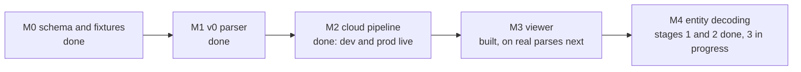

# demoView wiki

A guided tour of how demoView works and why it's built the way it is. It's for humans, including future-you after a month away.

**What this is not.** It isn't the spec, the plan or the running log. Those are the sources of truth, and the wiki explains them.

| File | Role |
| ---- | ---- |
| `../spec.md` | What to build. Wins any disagreement. |
| `../plan.md` | Checkpoints and status. |
| `../notes.md` | Dated decisions and findings. |
| **this wiki** | How it fits together, how the code actually works, and what we learned. |

If the wiki disagrees with the code, the code wins. Fix the wiki and put a line in the [changelog](changelog.md).

## One-minute version

You hand over a CS2 demo. You get back a scoreboard and a scrubbable 2D replay of every round. The demo parser is written from scratch in Go. The rest is plumbing: Cloudflare in front, a container running the parser behind.



- **Parser:** M1 is closed (`3bd6548`). The v0 done-when is met on the user's own matches: K/A/D, headshot kills and ADR equal the game's scoreboard counters for 80 of 80 players. `demo diff` passes locally on all 10 demos.
- **Round files:** 64 Hz, every tick, in the spec, the oracle and the samples.
- **Cloud:** the first green CI deploy put dev and prod live (run `36994672034`), which met M2's exit (`1244395`). The first real end-to-end parse took about 48 s, of which the parse was 31.6 s. See [infra](infra.md).
- **Entity decoding:** stages 1 and 2 are done, stage 3 (entity updates) is in progress.
- **Viewer:** upload, match and replay pages are built against synthetic fixtures, with the Mirage radar in.
- **Fixtures:** the two public demos plus 8 of the user's own MM/Premier demos, one of which has overtime. The shared fixtures bucket holds the two public ones only.

### Open items worth knowing

- **The viewer on a real parse.** It has only been run against the synthetic samples so far.
- **CI diff on fixtures.** Optional: set the read-only fixtures secrets so that job runs instead of skipping.
- **Fetching your own demos from Valve.** In scope, but after v1. The design is in `plan.md`, and nothing is started.
- **Narrative log.** The proposal is in `../logging.md` and awaits the user's six decisions. Don't build logging into the parser before then.

## The learning center

The same pages also run as a local site. **Tour** follows one demo through the whole system, with a live diagram and a small lab at the key steps. **Map** lets you click each part. **Lab** has the interactive models. **Pages** is this wiki. **Study** holds the optional extras: progress, notes, quizzes and flashcards from the glossary. Editing any page reloads the browser.

```sh
cd .claude/wiki/site && npm install && npm run dev   # opens http://localhost:5180
```

See `site/README.md` for how to add quiz questions and labs.

## How this wiki is kept

Sessions, by what they own: `parser` (`parser/`, `schema/`), `pipeline` (`worker/`, `web/` and the M3 viewer), `cloud` (infra and coordination), and this one (`.claude/wiki/`). They were `ide` and `terminal` earlier in the day. I read the git log, `plan.md`, `notes.md` and the touched code on a loop. I update the pages that moved and add a changelog entry. Pages are short and linked, with diagrams only where they teach something. Corrections are welcome. Just edit the page.
