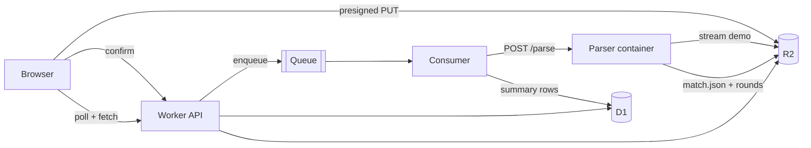
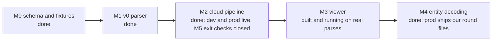

# demoView wiki

A guided tour of how demoView works and why it's built the way it is. It's for humans, including future-you after a month away.

**What this is not.** It isn't the spec, the plan or the running log. Those are the sources of truth, and the wiki explains them.

| File | Role |
| ---- | ---- |
| `../spec.md` | What to build. Wins any disagreement. |
| `../plan.md` | Checkpoints and status. |
| `../notes.md` | Dated decisions and findings. |
| **this wiki** | How it fits together, how the code actually works, and what we learned. |

If the wiki disagrees with the code, the code wins. Fix the wiki and put a line in the [changelog](changelog.md).

## One-minute version

You hand over a CS2 demo. You get back a scoreboard and a scrubbable 2D replay of every round. The demo parser is written from scratch in Go. The rest is plumbing: Cloudflare in front, a container running the parser behind.



## Where to start

| If you want to... | Read |
| ----------------- | ---- |
| See the whole system and follow one upload | [big-picture](big-picture.md) |
| Understand what's inside a `.dem` file | [demo-format](demo-format.md) |
| Walk through the Go parser, stage by stage | [parser](parser.md) |
| Learn how rounds, sides and winners are worked out | [match-logic](match-logic.md) |
| Know what `match.json` and round files contain | [schema](schema.md) |
| Understand the API, queue and status machine | [worker](worker.md) |
| See how the replay canvas works | [viewer](viewer.md) |
| See how we know the parser is right | [testing](testing.md) |
| Find cloud, CI and deploy details | [infra](infra.md) |
| Work with maps and radars | [maps](maps.md) |
| See where files live, and the proposed versioned layout | [r2-layout](r2-layout.md) |
| Reparse matches after a parser change | [runbook-reparse](runbook-reparse.md) |
| Diagnose a stuck or failed match | [runbook-stuck-matches](runbook-stuck-matches.md) |
| Read about Match Pulse, the win-probability line | [pulse](pulse.md) |
| Take over the wiki and the learning-center site | [pickup](pickup.md) |
| Find out why something is the way it is | [decisions](decisions.md) |
| Look up a term (tick, slot, oracle, DLQ) | [glossary](glossary.md) |
| See what changed lately | [changelog](changelog.md) |

## Status

Snapshot as of **2026-10-02**. The plan is canonical, so check `../plan.md` if this looks stale.



- **Parser:** M1 is closed (`3bd6548`). The v0 done-when is met on the user's own matches: K/A/D, headshot kills and ADR equal the game's scoreboard counters for 80 of 80 players. `demo diff` passes locally on all 10 demos.
- **Round files:** 64 Hz, every tick, in the spec, the oracle and the samples.
- **Cloud:** the first green CI deploy put dev and prod live (run `36994672034`), which met M2's exit (`1244395`). The first real end-to-end parse took about 48 s, of which the parse was 31.6 s. See [infra](infra.md).
- **Entity decoding:** M4 is done. Our own 64 Hz round files match the oracle on all 10 local demos, and the gate on 132 public tournament demos passed (0 blocking, 115 clean). **Prod now ships our own round files** (`93000d4`, deployed in run `37064251547`; prod's manifest shows `match_source=parser`, `round_source=parser`, no fallback), and the hourly reparse moves every match across. The oracle stays as the fallback. With M4 done, everything in v1 is built except the user's own desktop scrub check of the viewer.
- **Viewer:** upload, match and replay pages run against real parses on dev and prod, with map radars loaded through the API and per-match pipeline history on the match page. The one v1 item left is the user's own desktop scrub check.
- **Fixtures:** the two public demos plus 8 of the user's own MM/Premier demos, one of which has overtime. The shared fixtures bucket holds the two public ones only.

### Open items worth knowing

- **The desktop scrub check.** The user's own check that a replay opens and scrubs smoothly on a desktop browser. It is the last v1 done-when.
- **CI diff on fixtures.** A deploy can now require it, once the read-only fixtures secrets exist and the `REQUIRE_FIXTURE_DIFF` variable is set. Until then it skips.
- **Fetching your own demos from Valve.** Decided for v1.2, along with two-floor maps (Nuke, Vertigo). The design is in `plan.md`, and nothing is started.
- **v1.1.** M5 is closed (maps, duplicate reuse, safe reparse, self-recovery) and M6's parser-side hardening and dev shadow compare are done. Details are on [worker](worker.md), [r2-layout](r2-layout.md), [maps](maps.md) and the two runbooks.
- **ADR on pro demos.** The one follow-up from the tournament sweep: 5 full recordings show 2 to 11% ADR gaps for a few players, cause unknown. It blocks nothing. See [match-logic](match-logic.md#tournament-gotv-demos-the-gate-passed).
- **Narrative log.** The design is approved in full and the `parser/eventlog` groundwork is done. The output, schema and story pane are v1.2.
- **Match Pulse.** Approved for v1.2, and its back end is already built behind a flag on dev: a win-probability model on its own queue, a new `pulse.json`, a logistic fallback and a CI eval. The viewer side isn't recorded as built. See [pulse](pulse.md).

## The learning center

The same pages also run as a local site. **Tour** follows one demo through the whole system, with a live diagram and a small lab at the key steps. **Map** lets you click each part. **Lab** has the interactive models. **Pages** is this wiki. **Study** holds the optional extras: progress, notes, quizzes and flashcards from the glossary. Editing any page reloads the browser.

```sh
cd .claude/wiki/site && npm install && npm run dev   # opens http://localhost:5180
```

See `site/README.md` for how to add quiz questions and labs.

## How this wiki is kept

Sessions, by what they own: `parser` (`parser/`, `schema/`), `pipeline` (`worker/`, `web/` and the M3 viewer), `cloud` (infra and coordination), and this one (`.claude/wiki/`). They were `ide` and `terminal` earlier in the day. I read the git log, `plan.md`, `notes.md` and the touched code on a loop. I update the pages that moved and add a changelog entry. Pages are short and linked, with diagrams only where they teach something. Corrections are welcome. Just edit the page.
