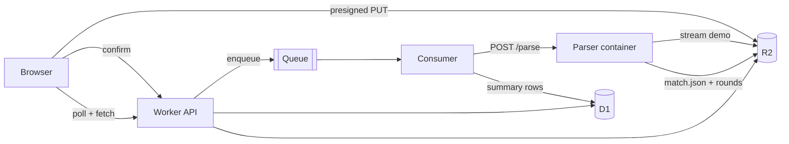
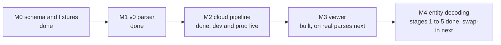

# demoView wiki

A guided tour of how demoView works and why it's built the way it is. It's for humans, including future-you after a month away.

**What this is not.** It isn't the spec, the plan or the running log. Those are the sources of truth, and the wiki explains them.

| File | Role |
| ---- | ---- |
| `../spec.md` | What to build. Wins any disagreement. |
| `../plan.md` | Checkpoints and status. |
| `../notes.md` | Dated decisions and findings. |
| **this wiki** | How it fits together, how the code actually works, and what we learned. |

If the wiki disagrees with the code, the code wins. Fix the wiki and put a line in the [changelog](changelog.md).

## One-minute version

You hand over a CS2 demo. You get back a scoreboard and a scrubbable 2D replay of every round. The demo parser is written from scratch in Go. The rest is plumbing: Cloudflare in front, a container running the parser behind.



## Where to start

| If you want to... | Read |
| ----------------- | ---- |
| See the whole system and follow one upload | [big-picture](big-picture.md) |
| Understand what's inside a `.dem` file | [demo-format](demo-format.md) |
| Walk through the Go parser, stage by stage | [parser](parser.md) |
| Learn how rounds, sides and winners are worked out | [match-logic](match-logic.md) |
| Know what `match.json` and round files contain | [schema](schema.md) |
| Understand the API, queue and status machine | [worker](worker.md) |
| See how the replay canvas works | [viewer](viewer.md) |
| See how we know the parser is right | [testing](testing.md) |
| Find cloud, CI and deploy details | [infra](infra.md) |
| Work with maps and radars | [maps](maps.md) |
| See where files live, and the proposed versioned layout | [r2-layout](r2-layout.md) |
| Reparse matches after a parser change | [runbook-reparse](runbook-reparse.md) |
| Diagnose a stuck or failed match | [runbook-stuck-matches](runbook-stuck-matches.md) |
| Find out why something is the way it is | [decisions](decisions.md) |
| Look up a term (tick, slot, oracle, DLQ) | [glossary](glossary.md) |
| See what changed lately | [changelog](changelog.md) |

## Status

Snapshot as of **2026-10-02**. The plan is canonical, so check `../plan.md` if this looks stale.



- **Parser:** M1 is closed (`3bd6548`). The v0 done-when is met on the user's own matches: K/A/D, headshot kills and ADR equal the game's scoreboard counters for 80 of 80 players. `demo diff` passes locally on all 10 demos.
- **Round files:** 64 Hz, every tick, in the spec, the oracle and the samples.
- **Cloud:** the first green CI deploy put dev and prod live (run `36994672034`), which met M2's exit (`1244395`). The first real end-to-end parse took about 48 s, of which the parse was 31.6 s. See [infra](infra.md).
- **Entity decoding:** stages 1 to 5 are done. Our own 64 Hz round files match the oracle on all 10 demos (players and kills with zero mismatches, byte-identical runs) and the full path takes 3.4 s and 108 MiB. **Left: the swap-in**, where the server ships our round files with an oracle fallback, and the dev shadow compare.
- **Viewer:** upload, match and replay pages are built against synthetic fixtures, with the Mirage radar in.
- **Fixtures:** the two public demos plus 8 of the user's own MM/Premier demos, one of which has overtime. The shared fixtures bucket holds the two public ones only.

### Open items worth knowing

- **The viewer on a real parse.** It has only been run against the synthetic samples so far.
- **CI diff on fixtures.** Optional: set the read-only fixtures secrets so that job runs instead of skipping.
- **Fetching your own demos from Valve.** Decided for v1.2, along with two-floor maps (Nuke, Vertigo). The design is in `plan.md`, and nothing is started.
- **v1.1.** Final in the spec (`6d603ba`): M5 (every single-level map, duplicate reuse, safe reparse, a stuck-match sweeper) and M6 (trust gates and hardening). The user has approved the versioned R2 layout, its D1 columns and the reparse cron (hourly, 5 per batch, paused at 80% of the monthly allowance, on in prod). Nearly all of M5 and the parser half of M6 are committed: maps, duplicate reuse, coded errors, the alignment tool, the versioned parse prefix with its pointer swap, the reparse route and hourly cron, the stuck-match sweeper, the rate limit, pipeline history in D1, the no-Stop rule, fuzzing, byte-identical parses and per-map diffs. **The crons are on in prod** (`6e305d0`) after the dev exit checks passed. Left: the R2 lifecycle rule for orphaned demos, the CI diff gate, and the shadow compare. The unknown-entity fallback exists in the parser and waits on the swap-in.
- **Tournament demos.** Match logic collapsed rounds on most public pro demos. The root cause is fixed (`68a02cf`), and the guard covered prod meanwhile. A re-run of all 132 is pending, and it gates the swap-in. See [match-logic](match-logic.md#tournament-gotv-demos-found-root-cause-fixed-re-run-pending).
- **Narrative log.** The design is approved in full and the `parser/eventlog` groundwork is done. The output, schema and story pane are v1.2.
- **Match Pulse.** A win-probability line under each round, approved for v1.2 after v1.1. See [decisions](decisions.md).

## The learning center

The same pages also run as a local site. **Tour** follows one demo through the whole system, with a live diagram and a small lab at the key steps. **Map** lets you click each part. **Lab** has the interactive models. **Pages** is this wiki. **Study** holds the optional extras: progress, notes, quizzes and flashcards from the glossary. Editing any page reloads the browser.

```sh
cd .claude/wiki/site && npm install && npm run dev   # opens http://localhost:5180
```

See `site/README.md` for how to add quiz questions and labs.

## How this wiki is kept

Sessions, by what they own: `parser` (`parser/`, `schema/`), `pipeline` (`worker/`, `web/` and the M3 viewer), `cloud` (infra and coordination), and this one (`.claude/wiki/`). They were `ide` and `terminal` earlier in the day. I read the git log, `plan.md`, `notes.md` and the touched code on a loop. I update the pages that moved and add a changelog entry. Pages are short and linked, with diagrams only where they teach something. Corrections are welcome. Just edit the page.
