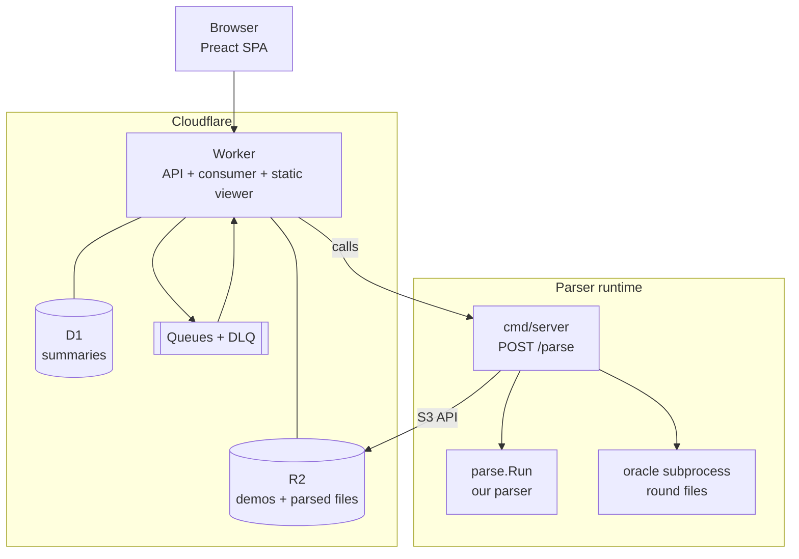

# Big picture

## Four principles

From the spec, and the reason most things look the way they do:

1. **Prod runs off-machine.** The browser uploads a file and draws a canvas. Everything else is in the cloud.
2. **Precompute at parse time.** The viewer fetches finished files and does no analysis. A feature that needs computing becomes a new parse output.
3. **The schema is the contract.** Parser writes it, everything else reads it. That's why the viewer and pipeline were built before the parser was done. See [schema](schema.md).
4. **An open-source parser is the answer key.** Every change is diffed against it. See [testing](testing.md).

## Components



| Piece | Lives in | One line |
| ----- | -------- | -------- |
| Parser | `parser/` | Go. Reads a demo as a stream, writes `match.json`. [parser](parser.md) |
| Oracle | `tools/oracle/` | Reference exporter on demoinfocs. Answer key, and today's round-file source. |
| Worker | `worker/` | API, queue consumer, D1 migrations, serves the viewer. [worker](worker.md) |
| Viewer | `web/` | Vite + Preact SPA, one canvas. [viewer](viewer.md) |
| Schema | `schema/` | JSON Schemas, validator, synthetic samples. |

## One upload, end to end

```mermaid
sequenceDiagram
    participant B as Browser
    participant W as Worker
    participant R as R2
    participant Q as Queue
    participant P as Parser
    participant D as D1
    B->>W: POST /api/matches (bearer token)
    W->>D: insert row, status uploaded
    W-->>B: id + presigned PUT URL
    B->>R: PUT demo (straight to R2)
    B->>W: POST /api/matches/:id/uploaded
    W->>R: HEAD, check size under 1 GB
    W->>D: status queued
    W->>Q: enqueue match_id
    Q->>W: deliver to consumer
    W->>D: status parsing
    W->>P: POST /parse {match_id, demo_key}
    P->>R: stream demo, parse
    P->>R: write rounds/NN.json, match.json, then manifest.json last
    P-->>W: 200 match.json
    W->>D: save players, rounds, kills; status ready
    loop every few seconds
        B->>W: GET /api/matches/:id
    end
    B->>W: GET rounds/:n (immutable, cached)
```

Details worth knowing:

- **The demo never passes through the Worker.** A Worker is capped at 128 MB, and a demo can be hundreds of MB. R2 receives the PUT directly.
- **A parse commits with its manifest.** The parser writes round files, then `match.json`, then `manifest.json` last, so a manifest means the rest is already there.
- **The parser never touches D1.** The Worker owns the database.
- **Every attempt has its own prefix.** A retry or reparse writes under a new `parse_id`, and D1 points at the live one, so nothing is overwritten in place.

## Why two parsers run in the container

v1 ships on round files from the oracle. Entity decoding (positions per tick) is the hardest part of the project and came last (M4). Our own round files now exist and match the oracle's, but the server still runs our parser for `match.json`, then pipes the demo through the oracle for round files, until the swap-in lands. See [parser](parser.md#the-server-and-the-consistency-guard).

## R2 layout

```text
demos/{match_id}.dem
parsed/{match_id}/{parse_id}/manifest.json
parsed/{match_id}/{parse_id}/match.json
parsed/{match_id}/{parse_id}/rounds/{NN}.json
maps/radars/*  maps/radar_info/*  maps/available.json  maps/manifest.json
```

Matches parsed before parse ids keep the older flat layout directly under `parsed/{match_id}/`, and D1's `live_parse_id` is empty for them. See [r2-layout](r2-layout.md). Maps are private, because the source repo has no license. Both buckets are `demoview-dev` and `demoview-prod`.
