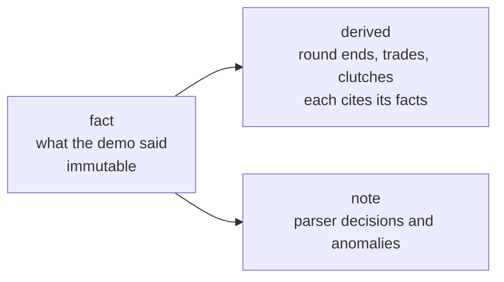

# Decisions

The *why* behind the shape of the project, newest first within each group. The dated log in `../notes.md` has the raw entries, and this page groups them.

## Architecture

| Decision | Why | Date |
| -------- | --- | ---- |
| **Parser runs on Cloudflare Containers, not Cloud Run** (user) | $5/month, one cloud, no public endpoint or shared secret. Cloud Run only if the project grows. The spec now says Containers throughout (`2811946`). The long-request test passed (360 s), and dev and prod both run it. | 10-02 |
| **v1 ships on oracle round files** | Entity decoding is the riskiest work. The spec's Fallback rule makes the reference parser the default, and ours swaps in at M4 when it passes the position diff. | spec |
| **Viewer served by the Worker** | Same origin, so no CORS on the API. One deploy. | 10-02 |
| **Vite + Preact, not React or Next.js** | A viewer that is mostly one canvas. The bundle went from 220 KB to 11 KB at the time of the switch. | spec |
| **Mirage for v1** | Single level. Nuke and Vertigo need a second radar layer. | spec |
| **Round files at 64 Hz, every tick** (user) | Both fixture demos record entity updates on every tick, and the viewer targets desktop. Superseded 16 Hz, then a brief 32 Hz. Cost: about 2 MB per long round before compression. | 10-02 |
| **v1.1 is final in the spec** (`6d603ba`, bar revised in `1d7ce68`) | M5 "every map and safe reparse": the maps route, duplicate reuse by hash on confirm, a reparse route and an hourly cron keyed on the last attempted build, a versioned parse prefix with a conditional D1 pointer swap, and a stuck-match sweeper. M6 "trusted and hardened": CI diff gates deploys, fuzz targets, byte-identical parses, a `GOMAXPROCS=1` budget check, and the oracle as fallback for entity-stage errors. No `schema_version` change. **The user has since approved the versioned R2 layout and its D1 columns.** The alignment bar is 97.5% per demo, not the 99.5% first drafted. See [maps](maps.md), [R2 layout](r2-layout.md) and the two runbooks. | 10-02 |
| **v1.1 sign-offs** (user) | The versioned R2 layout (`parsed/{id}/{parse_id}/`, `manifest.json` last) and its D1 columns: `live_parse_id`, the last attempted build, `status_changed_at`, `reparse_error` and `reparse_build`. The reparse cron: hourly, 5 matches a batch, pausing at 80% of the monthly container allowance, on in prod. The user's own demos stay local, and only the public fixtures go to R2. Recorded in `notes.md` (`4e06e12`). | 10-02 |
| **Match Pulse is approved for v1.2** (user) | A calibrated win-probability line under each round's scrubber, kill marks sized by swing, and a "rounds worth watching" shelf. A model on Workers AI runs on its own queue after a match is `ready` and writes a new `pulse.json` with its own schema. A self-grading loop scores every match against known outcomes, and a CI eval job tracks quality and drift. It may be evaluated locally on the user's own 8 matches. The experiment spend cap is $12.50 of the $25 loaded, confirmed by the user. v1.1 still comes first. Proposal in `../ideas/jev/`. | 10-02 |
| **The swap-in is built, and prod stays on `oracle`** | Our round files match the oracle on all 10 local demos, and a full-match shadow compare had 0 mismatches. But a bulk run on 132 public tournament demos collapsed rounds on 113, now fixed and being re-swept. So `PARSER_ROUNDS=parser` is opt-in, dev runs it with a shadow compare, and prod is set explicitly to the oracle until dev's shadow lines are clean and the sweep passes. | 10-02 |
| **No external demos on the user's machine** (user) | Tournament demos are tested through a CI research workflow against a pinned list, never downloaded locally and never rehosted. | 10-02 |
| **Keep Steam ids in public match data** (user) | The data is semi-anonymous behind unlisted links. `match.json` already serves them, and the summary GET omits them, which is fine. Settles the old open question, and `steam_id` stays non-nullable. | 10-02 |
| **v1.1 and v1.2 scope** (user) | v1.1's agreed set: reuse a duplicate upload by `demo_sha256`, a reparse path for older `parser_version`s, and more single-level maps. The contested items go to v1.2 because they need real work and credentials: the Steam/Valve fetch, and two-floor maps (Nuke, Vertigo). | 10-02 |
| **Pull the user's own demos from Valve** (user) | The spec had auto-fetching out of scope through v1. Now: a dedicated Steam bot account (never the main one), found by polling match history or a pasted share link, running in the cloud beside the parser, through network APIs only. The game-memory boundary still holds. **Decided: after v1.** The design is in `plan.md` (`6c9355e`) and nothing is started. | 10-02 |
| **v1 targets desktop browsers** (user) | The spec's done-when now says "desktop browser", not "phone or laptop" (`d56ca5a`). Touch still works on the scrubber, but it is no longer a gate. | 10-02 |
| **Solo build** | One milestone sequence M0 to M4, sized for agent-driven work. | 10-02 |

## Parser

| Decision | Why |
| -------- | --- |
| **Infer rounds from events (v0 stays events-only)** | Newer demos drop `round_start`, `round_end` and friends. Use them when present, infer when absent. Exact values wait for entity decoding at the front of M4. (10-02) |
| **Stop deaths at `cs_win_panel_match`** | The server inflicts world deaths after it. Whether the in-game scoreboard shows them is unsettled, so the user's own match screenshot decides. |
| **ADR from HP before minus HP after** | `dmg_health` is uncapped and rounded. Using `health` after each hit matches the game's `m_iDamage` exactly, so entities aren't needed for it. The first plan allowed 1% error. |
| **Consistency guard on `match.json`** | Round files index into kills. Ours ships only when it agrees with the oracle's, so the pair is always coherent. |
| **Match logic is two-phase (Recorder, then Build)** | Streaming stays cheap, since only a few thousand events are kept. Build is pure and testable with hand-made logs. |
| **Notes instead of warnings or errors** | Guesses are recorded in plain words and never change the output. |
| **`match.Kill.Attacker` is `*int`** | Null for world deaths, per the schema. Landed as `4c5ae64`. |

## Process

| Decision | Why |
| -------- | --- |
| **Hard boundary: never touch game memory** (user) | Only a `.dem` file the user hands over is ever input. No debuggers, overlays or process handles aimed at a game. If a task seems to need live access, stop and ask. |
| **Public demos as interim fixtures** (user) | Until their own demos arrive. |
| **Wrangler account and D1 ids committed** (user) | Approved explicitly. |
| **No Claude co-author trailer on commits** (user) | Existing commits keep it. |
| **Pathspec commits only** | Several sessions share one working tree. `git commit -m ... -- <paths>`, never `add -A` or `commit -a`. |
| **Deploy gated on CI** | Commits go straight to `main`, so the gate lives inside the deploy workflow. |
| **Schema changes are proposals** | The schema is the contract. Propose to the user first. A breaking change bumps `schema_version`. |

## Narrative log

**Status: design approved by the user on 2026-10-02**, all six decisions in `../logging.md` (`196517a`). The `parser/eventlog` groundwork lands in M4. The log output, its schema and the story pane are v1.2, so none of the output exists yet.

What was approved: the log is a new parse output under `parsed/{id}/log/{parser_version}/` with its manifest written last. It has its own `schema/log.schema.json` and `log_version`. It stores fields only, and a narrator function renders the text. The default is `--log full`. Parser hooks in `events/` and `matchlogic/` are allowed, and so is a D1 table for a pipeline timeline.

The idea: a structured, tick-stamped, versioned record of everything in the match and everything the parser decided. It's a *product output* stored in R2 next to `match.json`, and not platform logging. It might become a ledger or dataset later.

Three layers, so interpretations can be recomputed without the demo:

Notable design choices:
- Files are NDJSON gzipped, versioned by parser version. A manifest written last is the commit marker.
- No rendered sentences and no floats in the files. A pure `narrate(log)` function renders text, so wording changes need no reparse.
- Deterministic: same demo and parser gives byte-identical output.
- Measured: Mirage is 6.8k events in 66 KB gzipped, Nuke 16k in 143 KB.
- Matchlogic's `notes` become the `note` layer, which is why the idea fits what already exists.

Those were the six decisions asked of the user, and all six were approved.

## Logging audit

`cloud` ran a verified audit of what to log and where. The full report sits in its scratchpad, not in the repo, and **nothing from it is committed yet**. `pipeline` (formerly `terminal`) has the Worker items (W1 to W17) and `parser` (formerly `ide`) has the parser items (P1 to P19). The Worker ones already landing include a `match_status` line with the attempt number, a `dead_letter` line for every message, one `parse_call` line per attempt, and container start/stop/error lines. Guardrails: no per-request access logs, and never log presigned URLs, tokens, `env` or the container's `envVars`.

## Still open (from the spec)

- Does the reference parser cover every field in the schema? (Mostly yes, with demoinfocs.)
- Should a duplicate upload (same demo hash) reuse the existing match? Proposed for v1.1, not yet in the spec.
- Is the repo public from day one?
- Does Cloudflare Queues work on this plan? (Listed on Free, 24 h retention. Confirm in M2.)
