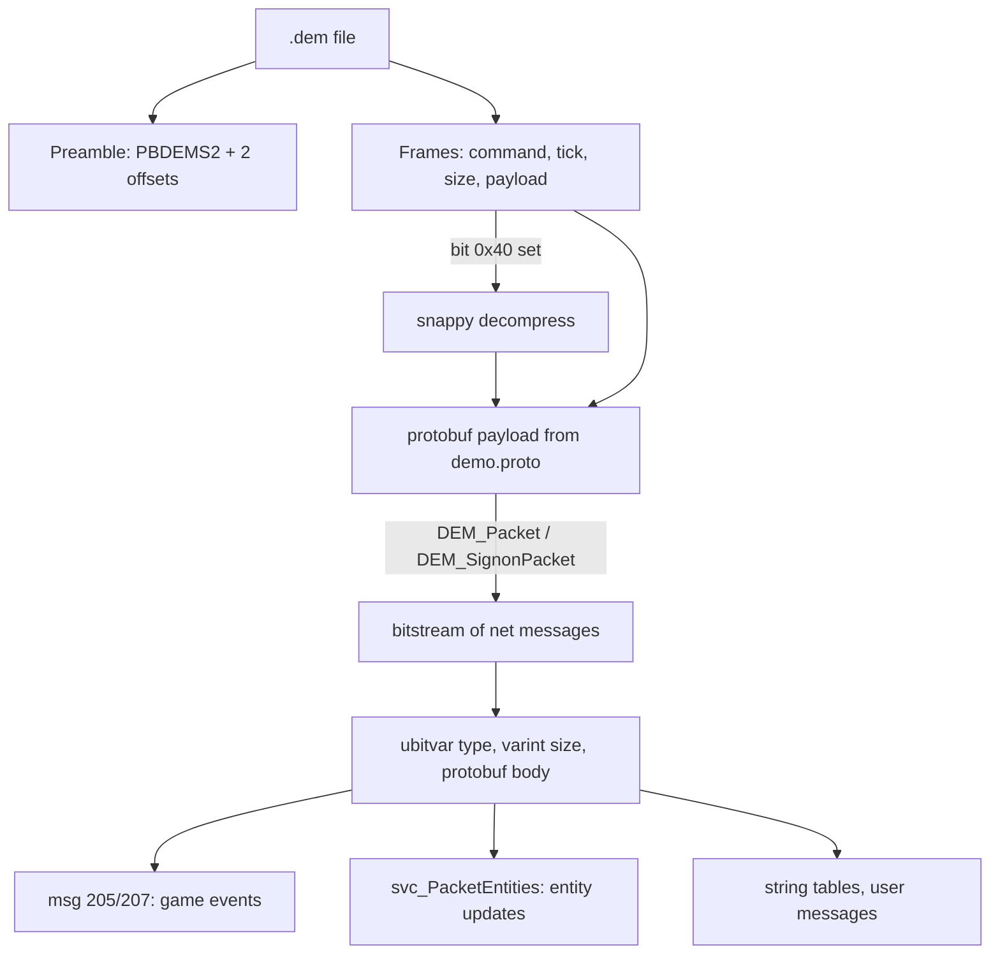

# Inside a CS2 demo

A `.dem` is a recording of everything the server told clients, in order. Replaying it means decoding that conversation. The format is layered, like nesting dolls.

<!-- widget: layers -->

## Layer by layer

**1. Preamble.** `PBDEMS2\0`, then two little-endian int32 offsets: file info and spawn groups. The file info frame sits at the first offset, which is a handy sanity check (`parser/demo/header.go`).

**2. Frames.** Each is a varint command type, a varint tick and a varint size, then the payload. If bit `0x40` of the command is set, the payload is snappy-compressed. The tick here is the *demo-frame tick*, and it is the clock we use everywhere. `net_Tick` inside packets runs on a different, offset clock.

**3. Packets.** `DEM_Packet` and `DEM_SignonPacket` wrap a bitstream, not a protobuf. Inside are net messages: a ubitvar type, a varint size, then the protobuf body. This is why the project has a bit reader (`parser/bitread`).

**4. What the messages carry.**

| Message | What it gives us | Used by |
| ------- | ---------------- | ------- |
| 205 `GameEventList` | Event descriptors: names, key names and types | [events](parser.md#events) |
| 207 `GameEvent` | The events: kills, hurt, bomb, round markers | match logic |
| `DEM_StringTables`, `FullPacket` | `userinfo`: who is in each player slot | [players](parser.md#players) |
| user message 375 | End-of-match player list with final teams | players |
| `svc_PacketEntities` | Entity state: positions, health, view angles | M4, not decoded yet |
| `DEM_SendTables` | Entity serializers (field layouts) | M4 |

## Things that bit us

- **Event ids shift between patches.** Never hardcode one. Map by name from the descriptor list.
- **Newer demos never fire `round_start`, `round_end`, `round_mvp` or `cs_win_panel_round`.** The descriptors are still listed, but the events don't come. Patch 13984 (early 2024) still fires them. So round logic must handle both without double counting. See [match-logic](match-logic.md).
- **"No player" has several spellings.** A type-9 key (`userid`, `attacker`, `assister`) uses 65535. Type-8 `*_pawn` keys use -1, or 0 for world damage. Some keys are plain shorts, like `other_death.attacker`.
- **Player identity is a two-step lookup.** `userid & 0xFF` is the slot. The `userinfo` string table is keyed by slot, and its `CMsgPlayerInfo.xuid` is the SteamID64 (0 for bots).
- **FullPacket string tables are deltas.** Most full packets carry no `userinfo`. On the FACEIT fixture, 8 of 38 snapshots do.
- **Bots stand in for disconnected humans** and can appear in kills.
- **`player_death` has junk around the match.** Nuke's 157 deaths split into 6 knife-round, 12 warmup, 138 live and 1 post-match `world` suicide. After the final scoreboard, the server kills players with `world`. These must not count.
- **World deaths look like suicides.** `attacker == userid` for world, fall and kick deaths, and a console `kill` is indistinguishable.

## Protobufs

Valve's `.proto` files come from SteamDatabase/GameTracking-CS2 (`Protobufs/`) and are pinned to game build 2000922. They are vendored and generated into `parser/pb`. A game update can change the format, so after each major patch the plan is to add a fresh demo to the fixtures.
