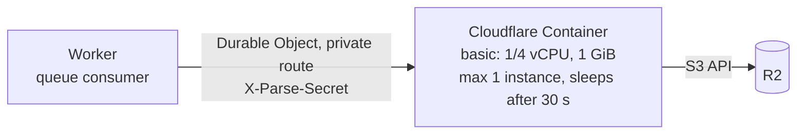
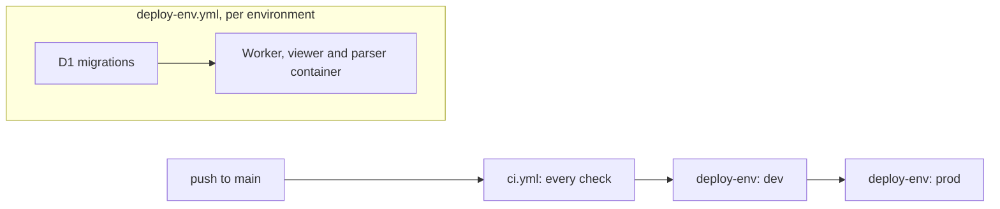

# Infra, CI and deploy

## Cloudflare

### Dev site

**https://demoview-api-dev.chiemeka-kalu.workers.dev** serves the viewer and `/api/*`. `/m/sample` replays the synthetic match. It's not a secret.

- Dev runs the real parser container (see below). **The first end-to-end parse passed:** a 166 MB played match went from upload to ready in about 48 s, with a 31.6 s parse on the first attempt and the full log trail visible. The D1 scoreboard equals what a local `demo parse` gives. Round files are brotli-compressed: 503 KB raw, 56 KB on the wire.
- **Prod is live**, deployed through CI. Run `36994672034` passed all 7 checks, then deployed dev and prod (version `bd466d33`), with both parser container apps ready.
- Observability is on in every environment, with invocation logs and 100% sampling (`51015a0`). Tracing is enabled in dev and prod too (`14e7130`), and the Worker now logs every parse attempt, dead letter and rejected confirm (`41ddb26`). Dev now runs the full observability block (version `a6c87d65`): logs and traces at 100% with persistence, issues enabled, and query strings left unredacted.

### Resources

Set up by the `cloud` session on 2026-10-02:

| Thing | dev | prod |
| ----- | --- | ---- |
| D1 | `demoview-dev` | `demoview-prod` |
| R2 bucket (CORS for browser PUT) | `demoview-dev` | `demoview-prod` |
| Queue + DLQ | `demoview-dev-parse[-dlq]` | `demoview-prod-parse[-dlq]` |
| Worker | `demoview-api-dev` | `demoview-api` |

- D1 has `0001_init.sql` applied in both.
- Each bucket has its own scoped R2 S3 token (tested), and the Worker secrets are set. The four secrets per environment are `UPLOAD_TOKEN`, `PARSE_SECRET`, `R2_ACCESS_KEY_ID` and `R2_SECRET_ACCESS_KEY`.
- The `demoview-fixtures` bucket exists and holds the two public fixtures only, at `demos/<name>.dem`. The user's own demos stay local.
- `maps/` in both buckets holds radars, radar info, `available.json` and a manifest. They're private because the source has no license.

## Parser runtime

**Decision:** Cloudflare Containers, not Cloud Run. It is a hobby project, and the $5/month Workers Paid plan buys one cloud, no public parser endpoint and no shared `PARSE_SECRET` surface. The spec and `CLAUDE.md` now say Containers everywhere Cloud Run used to appear (`2811946`).

**The question that was open, now settled.** The Containers docs give no request-duration limit, so a stub held one request open through the queue path for 360 s, and it ran in full. The stub was then removed (`62af2c3`).

**Cost.** Idle time is billed and the default `sleepAfter` is 10 minutes, which at 4 GiB would use up the monthly allowance in roughly 37 parses. The container class sets `sleepAfter = "30s"`, uses the `basic` instance type (1/4 vCPU, 1 GiB), and is capped at one instance. A parse takes seconds to about half a minute.

**Where it stands.** The Worker calls the parser through a `ParserContainer` binding, which replaced `PARSER_URL` (`9c7175e`). The parser route is private: only the Worker can reach it, and `X-Parse-Secret` stays as a second check. The prebuilt image is pushed to `registry.cloudflare.com`. The image listens on `$PORT` (8080), and `PARSE_SECRET` and the `R2_*` credentials reach it through the container's `envVars`. Dev and prod both run it.

**Pushing images.** `crane` v0.22.1 is installed (`~/go/bin/crane.exe`), so parser images can be pushed to the Cloudflare registry without Docker.

## CI

`.github/workflows/ci.yml` runs on pull requests, pushes to non-main branches, and as a gate inside every deploy. One job per part of the repo, in parallel:

| Job | Checks |
| --- | ------ |
| parser | `gofmt`, `go vet`, `go test` |
| oracle | the same, for `tools/oracle` |
| parser diff (fixtures) | pulls the public demos from `demoview-fixtures`, exports with the oracle, runs `demo diff`. Pull requests and branch pushes skip it without the read-only fixtures secrets. A deploy can require it: setting the repo variable `REQUIRE_FIXTURE_DIFF` to true makes a deploy fail without the secrets (`71baa69`, `95abc5c`). Until then a deploy skips it with a notice. |
| schema | validate the samples, `--strict` |
| worker | typecheck, lint (oxlint), tests |
| web | build, lint, tests |
| image | Docker build, no push |

Every job is pinned to `ubuntu-24.04` (`68070ae`). The checks are skipped on research branches (`6a0d344`).

## Deploy

The user commits straight to `main` with no pull request, so the CI gate runs *inside* the deploy workflow, and nothing ships unless every check passes. Deploys never run concurrently and are never cancelled halfway. `prod` can require reviewers for a manual approval.

**Status:** the first CI deploy was fully green (run `36994672034`): all 7 checks, then dev, then prod. That met the exit check for M2. The repo is `ChiemekaKalu/demoView` on GitHub (private).

Secrets and one-time setup live in `.github/README.md`. They're set at the repository level, because the image job runs outside any environment.

## Local dev

- `wrangler dev` emulates D1 and Queues locally. Run `npm run build:web` and `npm run migrate:local` first.
- Presigned URLs always point at real R2. For a local end-to-end run, `wrangler r2 object put ... --local` instead.
- Parser: `PARSE_SECRET=dev PARSER_STORE_DIR=out/store go run ./cmd/server` gives `POST /parse` on :8080 with a local store.
- **Local off switch:** `pwsh tools/local/stop-local.ps1` lists the dev servers and helpers the sessions started here (`vite`, `wrangler`, `workerd`, `esbuild`, `astro`, `vitest`, a reparse poller), and `-Force` stops them (`ddbb480`). The wiki's learning center on port 5180 is one of them. Production runs entirely on Cloudflare, so stopping everything locally only affects tooling.
