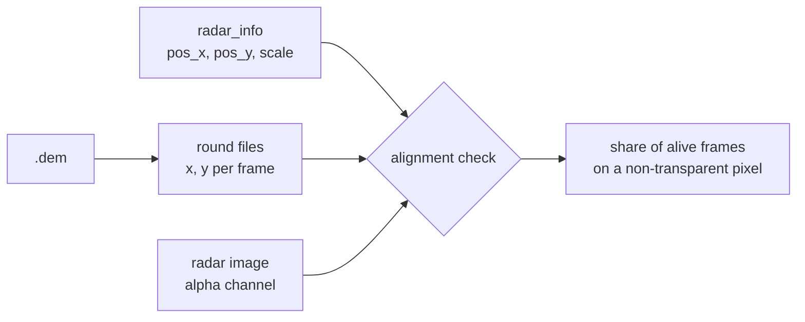

# Maps

How a game coordinate becomes a pixel on a radar, what exists today, and what v1.1 adds. **Today only Mirage is supported. Everything marked v1.1 is specified (`6d603ba`) and not built yet.**

## The conversion

A radar image is `size × size` pixels. Each map has three constants from its `radar_info` file, `pos_x`, `pos_y` and `scale`:

```text
px = (x - pos_x) / scale
py = (pos_y - y) / scale        // game y points up, image y points down
```

Mirage: `pos_x` −3230, `pos_y` 1713, `scale` 5.0, on a 1024×1024 radar. These were checked by plotting real positions from the oracle export, and trails follow the corridors. The [viewer](viewer.md#map-coordinates) page has an interactive version.

## Where the data lives

| What | Where | Notes |
| ---- | ----- | ----- |
| Radar images and `radar_info` | `maps/radars/*`, `maps/radar_info/*` in both R2 buckets | 100 objects, about 17 MB per bucket, hash-verified. Private, because the source repo (MurkyYT/cs2-map-icons at ae7ed6a) has no licence. |
| The index | `maps/available.json`, `maps/manifest.json` | Same buckets. |
| Mirage radar for the viewer | `web/public/radar/de_mirage.png` | The only radar committed to the repo. |
| Constants in code | `MAPS` in `web/src/lib/maps.ts` | Mirage only today. |

## What v1.1 changes

**The bar.** Every single-level map that has a radar under `maps/`. The local demos cover Mirage, Ancient, Inferno and Overpass, all of which the spec lists as single-level.

**Serving constants and radars.** The viewer reads `pos_x`, `pos_y` and `scale` through `GET /api/maps/:name`, which serves the private R2 objects with long-lived cache headers. It replaces the hard-coded table.

**A map without a radar** still replays on a plain background, with a "no radar for this map" notice.

**The alignment check.** A tool in `tools/` reports the share of alive player frames that land on a non-transparent radar pixel. It catches wrong constants before a viewer does.

- It runs **locally and on dev, not in CI**, because the radars are unlicensed private objects.
- The pass bar comes from a **measured Mirage baseline**, not a round number. Jump spots and boosts can legitimately sit off the radar, so 100% is the wrong target.



## Two-floor maps are v1.2

Nuke and Vertigo have two levels and need a second radar layer. The decided plan is a `z` or level column in round files and a layer toggle in the viewer. That changes the schema, so it is a `schema_version` bump, and it is why those maps wait for v1.2.

## Adding a single-level map (planned procedure)

1. Confirm the radar and its `radar_info` are in `maps/` in the dev bucket.
2. Run the alignment check on a demo for that map. Compare the share with the Mirage baseline.
3. If it is low, check `pos_x`, `pos_y` and `scale` before anything else. A sign error shows up as trails running off the image.
4. Open a replay on dev and look at spawns and bomb sites against the radar.
5. Only then expect the map to work on prod. No code change should be needed once the maps route exists.
