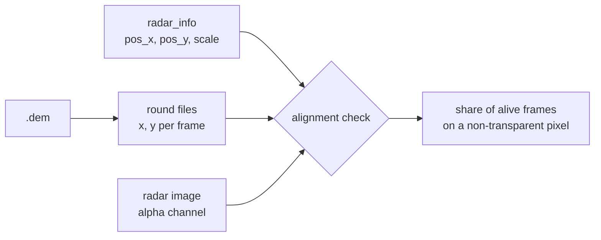

# Maps

How a game coordinate becomes a pixel on a radar, and how v1.1 serves radars for more maps. **The maps route, the viewer's loader and the alignment tool are committed. Which maps work end to end on dev and prod isn't recorded here yet.**

## The conversion

A radar image is `size × size` pixels. Each map has three constants from its `radar_info` file, `pos_x`, `pos_y` and `scale`:

```text
px = (x - pos_x) / scale
py = (pos_y - y) / scale        // game y points up, image y points down
```

Mirage: `pos_x` −3230, `pos_y` 1713, `scale` 5.0, on a 1024×1024 radar. These were checked by plotting real positions from the oracle export, and trails follow the corridors. The [viewer](viewer.md#map-coordinates) page has an interactive version.

## Where the data lives

| What | Where | Notes |
| ---- | ----- | ----- |
| Radar images and `radar_info` | `maps/radars/*`, `maps/radar_info/*` in both R2 buckets | 100 objects, about 17 MB per bucket, hash-verified. Private, because the source repo (MurkyYT/cs2-map-icons at ae7ed6a) has no licence. |
| The index | `maps/available.json`, `maps/manifest.json` | Same buckets. |
| Mirage radar for the viewer | `web/public/radar/de_mirage.png` | The only radar committed to the repo. |
| Constants for the viewer | `GET /api/maps/:name` | The viewer now loads each map's constants and radar through the API (`c996015`) instead of a hard-coded table. |

## What v1.1 changes

**The bar.** Every single-level map that has a radar under `maps/`. The local demos cover Mirage, Ancient, Inferno and Overpass, all of which the spec lists as single-level.

**Serving constants and radars (committed, `091b2b5`).** `GET /api/maps/:name` returns `{ name, pos_x, pos_y, scale }`, cached for a day, and `GET /api/maps/:name/radar.png` returns the image with an ETag. Both read the private R2 objects. A map with no radar gets a 404. **A two-floor map no longer does:** Nuke, Train and Vertigo used to get a 404 and so replayed on a plain grid that looked broken. The route now returns their main radar with `two_floor: true`, and both floors share it until v1.2 adds a radar per floor (`7916919`). The viewer draws them on that main radar with a note (`48bdb42`).

**A map without a radar** still replays on a plain background, with a "no radar for this map" notice.

**The alignment check.** A tool in `tools/` reports the share of alive player frames that land on a non-transparent radar pixel. It catches wrong constants before a viewer does.

- It runs **locally and on dev, not in CI**, because the radars are unlicensed private objects.
- The pass bar is **97.5% per demo** (`1d7ce68`), set from measured baselines and not a round number. Jump spots and boosts can legitimately sit off the radar, and some radars hug the walls, so 100% is the wrong target.

**What the tool measured** (`tools/align`, `2c3b41d`), per demo, on the oracle's round files:

| Map | Share on the radar | Note |
| --- | ------------------ | ---- |
| Mirage | 99.46 to 99.64% | Most misses are one stacked walkway the radar leaves transparent. |
| Ancient | 97.9 to 98.2% | The radar hugs the walls. This is what sets the bar. |
| Inferno | 99.4 to 99.98% | |
| Overpass | 99.68% | |

The radars are aligned: the best offset is within 2 px, and a 6 px shift drops every demo to 97.46% or below. A bar of 99.5% would have failed correctly aligned demos, which is why the spec now says 97.5% (`1d7ce68`). The tool exits 1 below the bar, is standard-library only, and also prints the busiest off-radar cells.



## Two-floor maps: a stopgap now, a real fix in v1.2

Nuke, Train and Vertigo have two levels and need a second radar layer. For now they show their **main radar** with a note, and players on the other floor land in the wrong place on it. The real plan is a `z` or level column in round files and a layer toggle in the viewer. That changes the schema, so it is a `schema_version` bump, and it is why those maps wait for v1.2.

## Adding a single-level map (planned procedure)

1. Confirm the radar and its `radar_info` are in `maps/` in the dev bucket.
2. Run the alignment check (`tools/align`) on a demo for that map. It should meet the 97.5% bar.
3. If it is low, check `pos_x`, `pos_y` and `scale` before anything else. A sign error shows up as trails running off the image.
4. Open a replay on dev and look at spawns and bomb sites against the radar.
5. Only then expect the map to work on prod. No code change should be needed once the maps route exists.
