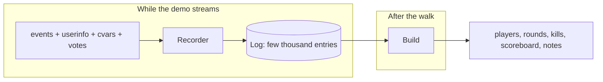
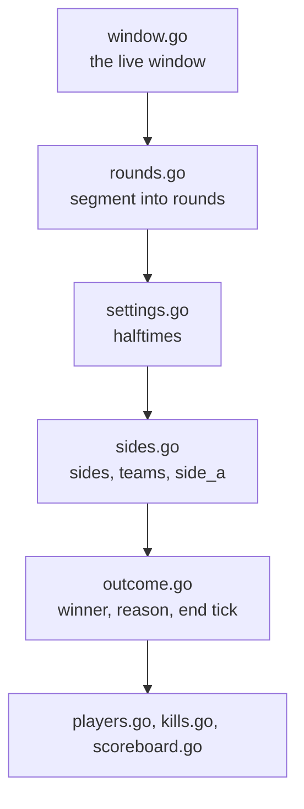

# Match logic

`parser/matchlogic/`. It turns a pile of game events into the players, rounds, kills and scoreboard of `match.json`. **Status:** committed (`fa3d8a9`, `671e08e`) and wired into `parse.Run`. On both interim demos, against the game's own counters, K/D/A, headshot kills and damage are exact for every player, and so is every round's winner, reason and end tick. Kills match the oracle row for row. Checkpoint 1.7's exit is met: on all 8 of the user's own MM/Premier matches, K/A/D, headshot kills and ADR equal the game's scoreboard counters exactly, for 80 of 80 players. Third-party stats sites can differ: one lists flash assists separately, so its assist counts are lower by exactly each player's flash assists, and it rounds ADR to a whole number. A demo with no live rounds is a bad demo (`22bb104`).

## The problem

You'd expect `round_start` and `round_end` to hand you the rounds. Newer CS2 demos never fire them, nor `round_mvp` or `cs_win_panel_round`. So the code reconstructs everything from the events that *do* fire, and uses the old ones only where they exist. Both reference parsers do the same, from entity props on `CCSGameRulesProxy`.

That means winners and teams are **inferred**, and surrenders or backup restores can fool the inference. Exact values come with entity decoding in M4.

## Two phases

The **Recorder** keeps only the events that matter and resolves each slot to a participant as it goes. **Build** is pure: log in, result out. That makes it easy to test with hand-made logs (`record_test.go`, `rounds_test.go` and friends).

## Build, step by step

**1. The live window.** From the last `begin_new_match` before the end, to the last `cs_win_panel_match`. This drops warmup, the knife round and the server's post-match deaths. Kills and damage count only inside it. Using the *last* of each means a server that starts a new match afterward doesn't hide the one that was played.

**2. Rounds.** A round starts at `round_prestart`, which is the first event of a restart (tournament demos fire none of the restart events during play, so the boundary falls back to `round_officially_ended`; see the section on GOTV demos below). Halftime swaps and spawns follow it, so splitting there keeps them in the right round. `round_start` and `round_poststart` stand in if it's missing. Round 1's `start_tick` is `begin_new_match`'s tick. A restart that never becomes a real round (no freeze end, round end or surrender) is folded into the previous round. The gap between a round's end and the next start belongs to the round that ended, so kills in it count there.

**3. Halftimes.** `announce_phase_end` marks one, and sides swap at the next restart. Without it, the cvar schedule decides: `mp_maxrounds` (default 24), `mp_overtime_maxrounds` (6) and `mp_halftime`. Overtime comes in blocks of `otRounds`, swapping at each block's half. If the event and the cvars disagree, the event wins and a note says so.

**4. Sides and teams.** The trickiest step. Team A is whoever was on CT in round 1. For each round, each participant's side comes from `player_team` events read at the round's end, and falls back to the end-of-match side carried back through the halftimes. `side_a` is the side most of team A was observed on. A participant's team is the one they were on in most of their rounds. Someone never observed takes the team opposite the players they fought.

**5. Outcomes.** If the demo has `round_end`, it provides the tick, winner and reason, and the inference runs anyway as a cross-check. Otherwise the inference is the answer. It walks the round's events in order and stops at the first thing that decides it:

| Event | Result |
| ----- | ------ |
| Bomb explodes | T win, `bomb_exploded` |
| Bomb defused | CT win, `bomb_defused` |
| Surrender vote passes | other side wins, `surrender` |
| Last living CT dies or leaves | T win, `elimination` |
| Last living T dies or leaves, bomb not planted | CT win, `elimination` |
| Timer runs out, bomb not planted | CT win, `time_expired` |

<!-- widget: roundsim -->

The timer length is `mp_roundtime_defuse` on `de_*` maps, else `mp_roundtime` (default 1.92 min). Living players are tracked from spawns, deaths and disconnects, using the sides the round was played on. If nothing decides a round, `guessOutcome` picks: a planted bomb means a T win, anything else a CT win on time. A note records the guess.

`round_end` reason codes 1, 7, 8, 9 and 18 are confirmed on a real demo. 12 and 17 follow the same numbering but haven't been seen.

## Notes, not warnings

`Result.Notes` is a list of plain-English "I had to guess" messages: `round 14: nothing decided it; guessed CT time_expired at tick 91234`. They never change the output. They're there for whoever debugs a weird parse. A match that ended in regulation before either team won also gets a note (a surrender or abandon the events don't show, probably).

## Scoreboard rules

Checked against the game's own counters on both demos:

- **Kills:** enemy kills only. Suicides and world deaths *don't* subtract. That changed from CS:GO. Team kills are unverified.
- **Deaths:** every victim inside the live window, suicides included.
- **Assists:** the `assister`, when on the other team from the victim. Flash assists count. No damage threshold.
- **HS%:** headshot kills / kills × 100, one decimal. 0 if no kills.
- **ADR:** enemy damage / all live rounds (the same denominator for everyone), one decimal, team damage excluded. Each hit counts as the victim's HP *before* minus `player_hurt.health` *after*. `dmg_health` is uncapped and rounded, so it overshoots on overkill. This matches the game's `m_iDamage` exactly, so the 1% tolerance in the plan is now a safety margin rather than something we use.

**Settled:** the game's end-of-demo death counter also includes world deaths inflicted *after* the win panel (+1 for one Nuke player, +9 of 10 on Mirage). We stop at the win panel, and that equals the counters the in-game scoreboard reads on all 80 players.

## Conventions shared with the oracle

These make the diff line up. See [schema](schema.md#conventions) for the file-level ones.

- `idx` order: team A first, then SteamID64 ascending, then name.
- A kill's `attacker` is null for world, fall and bomb deaths (weapon `world`, `worldspawn`, `trigger_hurt`, `planted_c4`). A console `kill` is indistinguishable and becomes null too.
- Bots who played a live round are listed with `steam_id` `"0"`. Nuke has one (Ava), giving 11 players.
- Weapon names are raw without the `weapon_` prefix. Knife skins stay raw, like `knife_widowmaker`.
- Bots are keyed by name, so a bot holding two slots is one player.
- Names come from the end-of-match message when it lists the player, which is what the game's scoreboard shows.
- An assister on the victim's own side is dropped from the kill list, as the oracle does.

## Tournament (GOTV) demos: found, root cause fixed, re-run pending

A bulk run of 132 public pro GOTV demos (builds 9842 to 10847) was run through the parser: no crashes, p95 1.6 s, the largest 61 MB. But match logic is not right on most of them:

| Finding | Count |
| ------- | ----- |
| Round segmentation collapses to a single round | 113 |
| Rejected as "no live rounds" (a 422) | 2 |
| Teams swapped (mostly the oldest build) | 9 |
| Minor round-1 and ADR differences | a few |

**Why prod stays correct today:** the consistency guard (see [parser](parser.md#the-server-and-the-consistency-guard)) ships the oracle's `match.json` whenever ours is implausible or disagrees, so the collapsed and swapped cases come out right. The two "no live rounds" demos still fail.

**The cause, confirmed and fixed (`68a02cf`):** tournament GOTV demos fire none of `round_prestart`, `round_start` or `round_poststart` during play. Splitting on the first of those seen anywhere therefore left the whole live window as one round, which is what happened on 113 of 132. The boundary kind is now chosen from the live window itself: the first of `round_prestart`, `round_start`, `round_poststart` and `round_officially_ended` that occurs once for every round after the first (the freeze ends minus one). `round_officially_ended` fires as the next round restarts, so when it is the boundary it ends the round *before* it rather than starting its own. All 10 local demos still diff clean against the oracle, and the user's own matches still equal the game's counters exactly.

**Fixed since, in the research branch's sweep:** round 1 keeps the spawns and team changes that come before `begin_new_match`, with its start clamped to the demo's first frame tick (`53df3af`). Unknown `E*` enum fields decode as varints, and a projectile class missing from an older build is skipped instead of failing the entity stage (`0108c53`, seen on the oldest build). The CLI diff still compares `match.json` when the round files fail (`1dd244c`). **Not ours:** the 2 "no live rounds" demos are rejected by the oracle too. **Now:** the sweep of the repros and then all 132 is running through a research workflow in CI, because no external demos go on the user's machine. The 10 local demos still match the reference, and the scoreboard check still matches the game's counters. The swap-in's prod flip waits for the sweep to pass.

## Verified and unverified

**Verified:** overtime swaps. Nothing happens entering overtime, then one swap at each overtime half, and modern demos give them directly through `player_team`. A 29-round overtime match diffs clean against the oracle.

**Still unverified,** because no fixture covers them, so treat these as assumptions:

- A round that runs out of time. The timer falls back to 1.92 min with a note when the cvars are missing.
- Reason codes 12 (time) and 17 (surrender, T side). Only a surrender is covered.
- Team kills (they shouldn't count or subtract) and coaches.
- Notes are returned by `Build` but not yet surfaced by the CLI or server.
