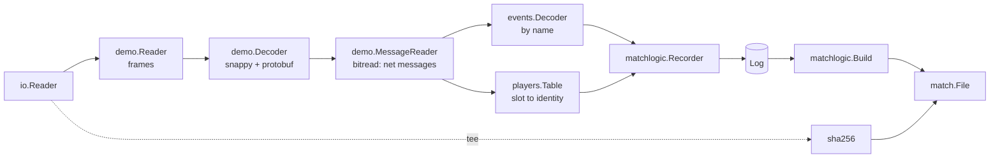
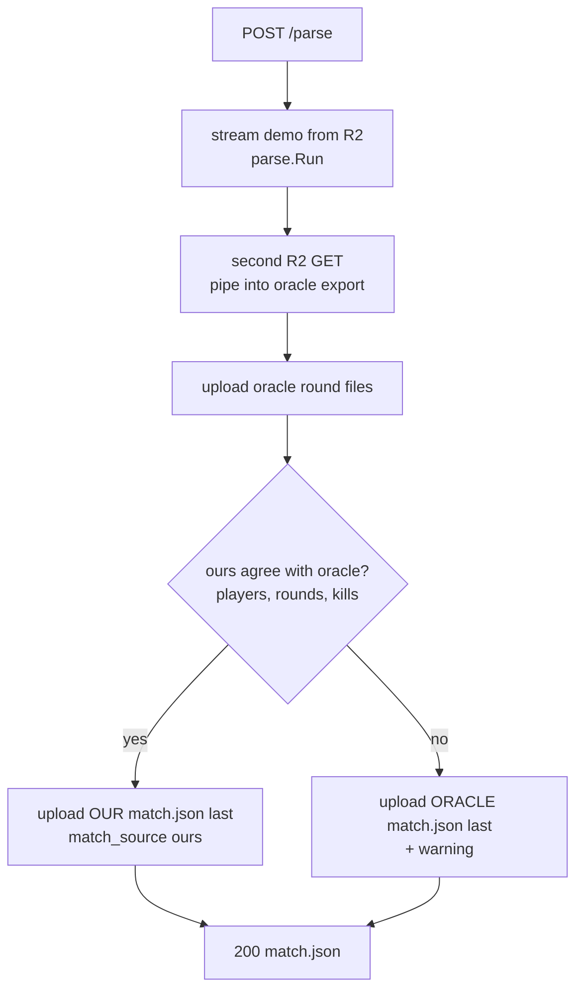

# The parser

Go, from scratch, under `parser/` (module `github.com/ChiemekaKalu/demoview/parser`). It reads the demo as a **stream** and never loads the whole file. Targets: under 512 MB and under 60 s for a full match on 1 vCPU.

Reference parsers (demoinfocs, demoparser) are test oracles only. `parser/` never imports or copies from them. Protobuf and snappy libraries are fine.

## The pipeline



`parse.Run(ctx, r)` is the single entry point and the CLI and the server share it, so both accept and reject exactly the same demos. It walks every frame and every packet message. A malformed demo fails with an error wrapping `demo.ErrBadDemo`, and so does one with no live rounds, because an empty `match.json` would fail the schema. The context is checked every 4096 frames so a cancelled request stops promptly. The SHA-256 is computed in the same pass with a `TeeReader`.

## Packages

| Package | Job |
| ------- | --- |
| `demo` | Preamble, frame reader, decoder (snappy + protobuf), packet `MessageReader` |
| `bitread` | Bitstream reader: ubitvar, varints, the bit-level primitives |
| `pb` | Generated Valve protos, pinned to game build 2000922 |
| `events` | Game event descriptors and decoding, always by name |
| `players` | Slot to identity: userinfo snapshots and the end-of-match list |
| `matchlogic` | Events to rounds, sides, kills and scoreboard. See [match-logic](match-logic.md) |
| `match` | Output types for `match.json` |
| `parse` | `Run`, the shared parse path |
| `diff` | Compare our output with the oracle's. See [testing](testing.md) |
| `store` | Object store: R2 over S3, or a local directory |
| `cmd/demo` | The CLI |
| `cmd/server` | The container service |

## Events

`events.Decoder` learns descriptors from message 205 and decodes message 207 against them. Ids are never hardcoded, because they shift between patches. Key types map to `val_*` fields in the protobuf. Types 8 and 9 reuse `val_long` and `val_short`. Callers ask for events and keys by name (`e.String("cvarname")`). An event before the descriptor list, or with an unknown id, is a bad demo.

## Players

Events name players by `userid`, whose low byte is the slot. The `userinfo` string table maps slot to `CMsgPlayerInfo`, which holds the name and SteamID64. It shows up in `DEM_StringTables` at signon and in some `DEM_FullPacket`s (as deltas). Updates in between come as `svc_UpdateStringTable`, which we don't decode. Instead `player_connect` events patch the table via `Table.Set`, and that covers a bot filling in for someone who left. The end-of-match message (375) gives final teams.

Each event's slot is resolved to a stable **participant** at the moment it arrives. A slot that changes hands mid-match still credits the right person.

## The CLI

```sh
demo parse <file.dem> --out <dir> [--events-only]
demo inspect <file.dem>        # dev only: frame stats, map, build, ticks
```

On failure it writes one JSON line to stderr, `{"error": "...", "code": "..."}`. The exit code is **1** for `bad_demo` (the server maps it to HTTP 422), **2** for `usage` and **3** for `internal` (5xx). `demo diff <file> --against <reference.json>` parses the demo and prints the diff report (exit 1, code `mismatch`, on any difference). Committed as `0d283b4`; both interim demos diff OK.

## The server and the consistency guard

`cmd/server` is `POST /parse` plus `GET /healthz`. It authenticates with `X-Parse-Secret` (compared as hashes in constant time), and writes one JSON log line per parse.



**Why the guard.** Round files index into `match.json` (an event's `kill` is an index into `kills`). If our `match.json` disagreed with the oracle's round files, the viewer would mis-point kill markers. So ours ships only when it agrees. Otherwise the oracle's ships, with a warning, and the files always agree with each other. Real demos: ours agrees and ships. Nuke takes about 3.7 s, with the oracle child peaking at 219 MB.

<!-- widget: guard -->

Two modes are worth knowing about:

- **Stub mode** (`PARSER_STUB_DIR`): copies fixture files instead of parsing. This let the cloud pipeline be built before the parser existed.
- **Store**: R2 in the cloud (aws-sdk-go-v2 `s3` only), a local directory with `PARSER_STORE_DIR`.

The Dockerfile's build context is the repo root, so `schema/samples` lands in the image as `/fixtures`. It also carries the `oracle` binary. The image now runs on dev as a Cloudflare Container.

The server logs one JSON line for every parse and no longer leaks secrets into logs (`14ec9f0`). `parse.RunStats` returns counts alongside the result (`52f8113`).

## What's not here yet

Entity decoding (M4) is the hardest part of the project, and it has started early as standalone packages that are not yet wired into `parse.Run`:

- **Stage 1, classes and serializers** (`parser/entities`): done (`bf09f8f`). Field layouts exist for every class on both demos: 211 and 218 classes, about 1.5k distinct fields. A pawn's position is `m_skeletonInstance.m_vecOrigin` (cell plus offset per axis), and the view angle, health and life state are `m_angEyeAngles`, `m_iHealth` and `m_lifeState`. Still unverified until real data is read: the health clamp encoding, `minusone`, sim-time fields by name, pointer presence bits, and how a polymorphic pointer picks its type.
- **Stage 2, string tables** (`parser/stringtables`): done. In-packet create, update and clear messages match every snapshot byte for byte on both demos (`c9e9bd7`). Open item: Mirage has instance-baseline keys like `43:0` to `43:27` with an unknown suffix, so baselines are looked up by the bare class id.
- **Stage 3, entity updates** (field paths, value decoders, create/update/delete): in progress. The position diff runs against the oracle's round files.
- **Stages 4 and 5, extraction and round files** at 64 Hz: then swap them in for the oracle's.

Entity decoding also decides exact round winners and teams, which events can only infer.

Alongside it, `parser/eventlog` is the approved groundwork for the narrative log: an envelope, an emitter interface with a no-op, a spool and a deterministic finalizer, with tests. It writes no output yet. See [decisions](decisions.md#narrative-log).
