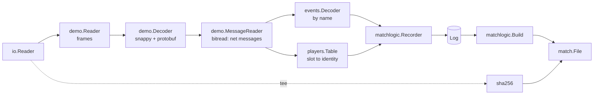
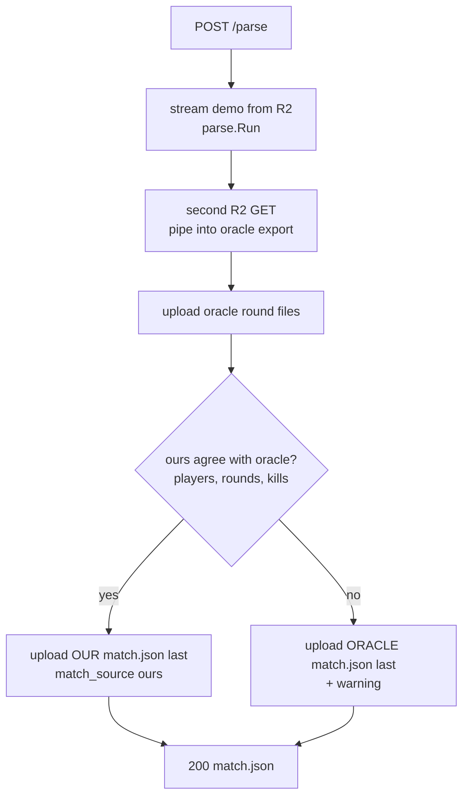

# The parser

Go, from scratch, under `parser/` (module `github.com/ChiemekaKalu/demoview/parser`). It reads the demo as a **stream** and never loads the whole file. Targets: under 512 MB and under 60 s for a full match on 1 vCPU.

Reference parsers (demoinfocs, demoparser) are test oracles only. `parser/` never imports or copies from them. Protobuf and snappy libraries are fine.

## The pipeline



`parse.Run(ctx, r)` is the single entry point and the CLI and the server share it, so both accept and reject exactly the same demos. It walks every frame and every packet message. A malformed demo fails with an error wrapping `demo.ErrBadDemo`, and so does one with no live rounds, because an empty `match.json` would fail the schema. The context is checked every 4096 frames so a cancelled request stops promptly. The SHA-256 is computed in the same pass with a `TeeReader`.

## Packages

| Package | Job |
| ------- | --- |
| `demo` | Preamble, frame reader, decoder (snappy + protobuf), packet `MessageReader` |
| `bitread` | Bitstream reader: ubitvar, varints, the bit-level primitives |
| `pb` | Generated Valve protos, pinned to game build 2000922 |
| `events` | Game event descriptors and decoding, always by name |
| `players` | Slot to identity: userinfo snapshots and the end-of-match list |
| `matchlogic` | Events to rounds, sides, kills and scoreboard. See [match-logic](match-logic.md) |
| `match` | Output types for `match.json` |
| `parse` | `Parse` (with `Options{Rounds}`) and the events-only `Run`: the shared parse path. An entity-stage error stops only round files |
| `stringtables` | In-packet string tables, including instance baselines |
| `entities` | Serializers, field paths and entity state |
| `extract` | Per-tick player and grenade tracks from entity state |
| `roundfile` | Round-file types and the writer |
| `eventlog` | Narrative-log groundwork, not wired in until v1.2 |
| `diff` | Compare our output with the oracle's. See [testing](testing.md) |
| `store` | Object store: R2 over S3, or a local directory |
| `cmd/demo` | The CLI |
| `cmd/server` | The container service |

## Events

`events.Decoder` learns descriptors from message 205 and decodes message 207 against them. Ids are never hardcoded, because they shift between patches. Key types map to `val_*` fields in the protobuf. Types 8 and 9 reuse `val_long` and `val_short`. Callers ask for events and keys by name (`e.String("cvarname")`). An event before the descriptor list, or with an unknown id, is a bad demo.

## Players

Events name players by `userid`, whose low byte is the slot. The `userinfo` string table maps slot to `CMsgPlayerInfo`, which holds the name and SteamID64. It shows up in `DEM_StringTables` at signon and in some `DEM_FullPacket`s (as deltas). Updates in between come as `svc_UpdateStringTable`, which we don't decode. Instead `player_connect` events patch the table via `Table.Set`, and that covers a bot filling in for someone who left. The end-of-match message (375) gives final teams.

Each event's slot is resolved to a stable **participant** at the moment it arrives. A slot that changes hands mid-match still credits the right person.

## The CLI

```sh
demo parse <file.dem> --out <dir> [--events-only]
demo inspect <file.dem>        # dev only: frame stats, map, build, ticks (--events: round-structure timeline)
```

On failure it writes one JSON line to stderr, `{"error": "...", "code": "..."}`. The exit code is **1** for `bad_demo` (the server maps it to HTTP 422), **2** for `usage` and **3** for `internal` (5xx). `demo diff <file> --against <reference.json>` parses the demo and prints the diff report (exit 1, code `mismatch`, on any difference). Committed as `0d283b4`; both interim demos diff OK.

## The server and the consistency guard

`cmd/server` is `POST /parse` plus `GET /healthz`. It authenticates with `X-Parse-Secret` (compared as hashes in constant time), and writes one JSON log line per parse.



**Why the guard.** Round files index into `match.json` (an event's `kill` is an index into `kills`). If our `match.json` disagreed with the oracle's round files, the viewer would mis-point kill markers. So ours ships only when it agrees. Otherwise the oracle's ships, with a warning, and the files always agree with each other. Real demos: ours agrees and ships. Nuke takes about 3.7 s, with the oracle child peaking at 219 MB.

<!-- widget: guard -->

Two modes are worth knowing about:

- **Stub mode** (`PARSER_STUB_DIR`): copies fixture files instead of parsing. This let the cloud pipeline be built before the parser existed.
- **Store**: R2 in the cloud (aws-sdk-go-v2 `s3` only), a local directory with `PARSER_STORE_DIR`.

The Dockerfile's build context is the repo root, so `schema/samples` lands in the image as `/fixtures`. It also carries the `oracle` binary. The image now runs on dev as a Cloudflare Container.

The server logs one JSON line for every parse and no longer leaks secrets into logs (`14ec9f0`). `parse.RunStats` returns counts alongside the result (`52f8113`).

Round segmentation is its own stage now: a `normalize` step turns each demo into a standard round timeline before scoring (see [match-logic](match-logic.md)).

## Hardening (M6, parser side)

| Item | State |
| ---- | ----- |
| A stream that ends without a Stop frame is `bad_demo` ("truncated: no Stop frame") | Done (`27de943`). All 2,000 truncations of the two public demos are rejected with no panic. |
| Fuzz targets | Done: `bitread`, `FuzzFrames` (frame loop, decoder, messages), `FuzzApply` (string tables and entities) and `FuzzFieldPaths`, crash-free at 60 s. Writing them found two real entity bugs, now fixed (`ad573c1`): a dynamic-array write past its length, which let reads return elements past the end, and a baseline cache keyed by a negative or missing index, which a crafted demo could grow without limit. |
| Two parses in separate processes are byte-identical | Done: `match.json` is identical on all 10 local demos. |
| Budget at `GOMAXPROCS=1` | Events-only: 0.58 s at 17 MiB. **Our own full path with round files: 3.4 s and 108 MiB**, on the largest demo, well inside 512 MiB and 60 s. The oracle path measures about 270 MiB after its sample compaction (`23e232c`) and runs under a 400 MiB cap (`fe09822`). |
| Per-map diff coverage | Done (`3c86e04`): one subtest per map and demo, all OK. |

The narrative log's groundwork (`parser/eventlog`, `06ca637`) is done: facts, derived records and notes as NDJSON with a gzip whose mtime is 0, floats and times impossible by construction, golden and run-twice tests, about 0.5 microseconds per record. The rest of that design is v1.2.

## Entity decoding (M4) and what's left

Our own round files now exist. The work started early as standalone packages and is done through extraction:

- **Stage 1, classes and serializers** (`bf09f8f`): field layouts for 211 and 218 classes, about 1.5k distinct fields. A pawn's position is `m_skeletonInstance.m_vecOrigin` (cell plus offset per axis), and the view angle, health and life state are `m_angEyeAngles`, `m_iHealth` and `m_lifeState`.
- **Stage 2, string tables** (`c9e9bd7`): in-packet create, update and clear messages match every snapshot byte for byte on both demos. Baselines are looked up by the bare class id.
- **Stage 3, entity updates** (`1abbf6d`, `d455cbf`): pawn x, y, yaw and hp agree with the oracle on 100% of frames on all 10 demos, and every `svc_PacketEntities` message (1.18 million) is consumed exactly. Field paths use a 40-op Huffman table whose tie-break rule was found empirically. Only the *first* full packet's entities are applied, because later ones omit fields.
- **Stages 4 and 5, extraction and round files** (`73bf5f8`, `d7352db`, `0eaa37c`): `extract` records each player's x, y, yaw and hp per tick (about 7 bytes a player) and each grenade's path, with throw, detonate and end moments from the game events. `roundfile` writes them. `demo parse` writes `rounds/NN.json` unless `--events-only`, and `demo diff` compares each round file when the reference has them.

**Against the oracle on all 10 demos:** players and kill events have zero mismatches, and output is byte-identical across runs. Grenades differed only where the oracle departed from the project's conventions: a fire ended at entity removal about 13 s after it burned out, a fire's last path point was `[0,0]`, and one decoy never detonated. The oracle was fixed to match (`5d0c7fe`): fires now end at the game's own fire events and decoys at removal.

**An entity-stage error stops only that stage.** `entities.ErrUnknown`, for a field with no decoder or a class id outside the class list, wraps `ErrBadDemo`. `match.json` stays complete, and the CLI exits 1 with code `unknown_entity`. That is how a CS2 update can degrade round files without taking parses down.

**The swap-in is built** (`1587e55`, `de2ff27`). `PARSER_ROUNDS=parser` is opt-in, and the image's default stays `oracle`. In parser mode the server ships our round files, so `match_source` and `round_source` are both `parser` and no consistency guard is needed, because both come from one parse. It falls back to the oracle path (guard included) on an entity-stage error or an implausible match (fewer than 2 live rounds, or no kills), logging one `round file fallback` warning with the reason. `PARSER_SHADOW=oracle` is dev only: after the response is flushed, the oracle runs again and its `match.json` and round files are diffed against what shipped, logging one `shadow` line with counts by category and writing each compare's verdict to `shadow.json` (`ad0f9d3`). It never writes to the store, and responses carry `Content-Length` so the Worker never waits on it. Startup refuses inconsistent settings. On a full Mirage match the shadow compare gave 10 rounds and 0 mismatches. **The dev shadow compare passed** (M6, 6.6): dev ships our own round files, and all three dev matches reparsed with a `shadow.json` of `result: match`, `round_source: parser` and 0 mismatches over 19, 10 and 19 rounds. An independent diff of the deployed files against local oracle exports also found 0 mismatches. The oracle re-run takes 15 to 63 s on the `basic` instance after the response, so dev's container sleeps after 2 minutes to let it finish. Container output never reaches `wrangler tail`, which is why the verdict is saved as a file. Also, in parser mode, if the oracle fails on a match that looks plausible, the server ships our files rather than failing (`a40a665`). **The gate passed and prod flipped** (`93000d4`): prod's container now runs with `PARSER_ROUNDS=parser` and the shadow compare off. The round mode is part of the build id, so the hourly reparse moves every prod match onto our own round files with no hand step. The oracle remains the fallback, and the shadow compare stays a dev tool. See [match-logic](match-logic.md#tournament-gotv-demos-the-gate-passed). Never pass an empty `PARSER_ROUNDS` in prod, since it would override the image default. Entity decoding also decides exact round winners and teams, which events can only infer.
