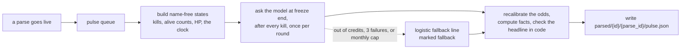

# Match Pulse

A win-probability line under each round's scrubber, with kill marks sized by how much they swung the odds and a shelf of "rounds worth watching". **It is approved for v1.2 and the back end is built behind a flag, on dev only. The viewer side isn't recorded as built.**

## What it is

It runs on **its own queue** after a match is live, so a slow or exhausted model never touches the parse. It is on when `PULSE_ENABLED` is `true`, which is dev only for now (`31b2e5f`).

## How it works

- **States have no names.** Each state is built from `match.json` and the round files and holds only kills, alive counts, HP and the clock (`state_version` 1). The bomb timeline arrives in state version 2.
- **The model is asked at the moments that matter:** at freeze end, after every kill, and once per round. Calls are paced (at most 4 in flight and 4 a second) and rate limits are retried 4 times. A tick gives one moment, after its last kill, because the schema rejects two moments with equal ticks (`252830d`).
- **The odds are recalibrated** with a fixed temperature (0.54), the facts are computed in code, and the headline is checked in code rather than trusted from the model.
- **It grades itself.** Each Pulse is scored against the real round winners and saved as `pulse_quality`. A match costs about a cent.
- **It degrades instead of disappearing.** When the model runs out of credits, keeps failing for 3 attempts, or the month's 50M-token cap is reached, a 7-weight logistic model draws the line instead (`model: fallback-logit-v1`, no highlights), and the Pulse is marked `fallback` rather than missing.

## The file

`pulse.json` is a **new file with its own `pulse_version`** (1), and `match.json` and the round files are untouched, so `schema_version` is unchanged (`9b0251d`). The validator pairs a pulse file with the `match.json` beside it and checks that its rounds exist there, that moment ticks strictly increase inside each round, and that every `swing_tick` is one of the moment ticks. A synthetic pulse file ships with the samples. See [schema](schema.md).

## Routes

| Route | Does |
| ----- | ---- |
| `GET /api/matches/:id/pulse.json` | The parse's Pulse, cached as `match.json` is. 404 when Pulse is off or not written yet. |
| `POST /api/matches/:id/pulse` | Queue a Pulse for the live parse. 401, 404, or 409 when Pulse is off or there is no live parse. |

## Keeping it honest

A CI eval scores the model on 225 moment states and 28 round states drawn from the two public fixtures, built by the real state builder with names blanked (`8335413`). It measures calibration and ranking quality (Brier score, AUC, expected calibration error), how the round was won, and headline precision against the real results. It also checks the fallback, the schema and determinism, and fails past fixed bars. It runs on Pulse changes, weekly and by hand, costs about a cent a run, and skips when the token is absent.

A fallback Pulse file's contents are described in the schema docs (`edf0090`). `pulse.json` is cached briefly, even when a named parse is requested (`e953cd6`). The eval judges canaries within a tolerance for the model's measured jitter and checks headlines per state version, and the state-version-1 headline bar is provisional (`a341aa5`, `6abed7c`, `9e9e98e`).

## Decided, and not yet built

The experiment spend cap is $12.50 of the $25 loaded. The model may be evaluated locally on the user's own matches. See [decisions](decisions.md).
