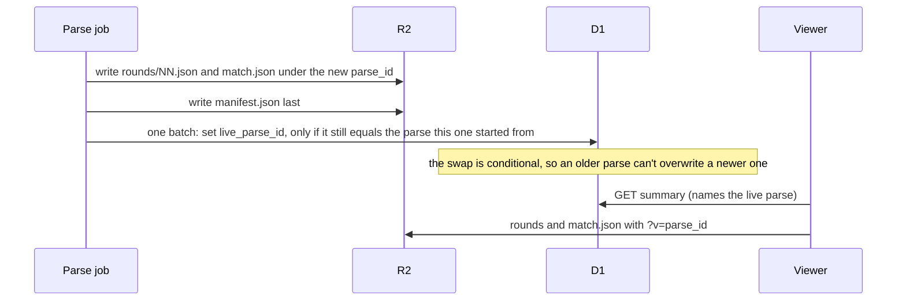

# R2 layout and versioned parses

> **Pending user sign-off.** The versioned layout below is the v1.1 spec's proposal (`6d603ba`). It changes where parsed files live, and the user has not signed it off yet. Nothing here is built. The *current* layout is in the first section and is what runs today.

## Today

```text
demos/{match_id}.dem
parsed/{match_id}/match.json
parsed/{match_id}/rounds/{NN}.json
maps/radars/*   maps/radar_info/*   maps/available.json   maps/manifest.json
```

A parse overwrites those keys in place, which is safe for a retry. It has one flaw: a reparse that yields fewer rounds leaves the old `rounds/NN.json` files behind. They are harmless today, because the round list comes from D1, but they are still reachable by URL.

## Proposed for v1.1

Each parse gets its own prefix, and D1 says which one is live.

```text
parsed/{match_id}/{parse_id}/manifest.json     counts and sha256s, written last
parsed/{match_id}/{parse_id}/match.json
parsed/{match_id}/{parse_id}/rounds/{NN}.json
```



**Why a pointer.** A reader polling during a reparse must never see a 404 or a mix of two parses. Old files stay where they are until D1 points somewhere else, and the pointer moves in a single step.

### Rules

| Rule | Detail |
| ---- | ------ |
| Commit marker | `manifest.json` is written last. Its presence means the parse is complete. |
| The swap | One D1 batch sets `live_parse_id`, conditional on the previous value. All success writes go in the same batch. |
| URLs | `/rounds/:n?v=<parse_id>` and the same for `match.json` serve that parse with an **immutable** cache header. Without `v`, the route serves the live pointer with a **short** cache. |
| A pruned version | If a versioned URL returns 404, the viewer refetches the summary once and tries the new pointer. |
| Cleanup | Parses D1 no longer points to are deleted after **7 days**. |
| v1 files | Files directly under `parsed/{id}/` from before this change are deleted **by exact key**. Cleanup never lists or deletes the whole `parsed/{id}/` prefix, because that is the parent of the new prefixes. |

### What it fixes

A reparse with fewer rounds leaves no old round file reachable, because the new parse is a separate prefix and the old one is removed on schedule.

### D1 columns it relies on

`live_parse_id` (new), `demo_sha256` (indexed), `status_changed_at`, the last-attempted-build column, and `reparse_error` and `reparse_build`. See the [reparse runbook](runbook-reparse.md). These are spec changes and not schema-file changes, so `schema_version` stays 1.

## Open points

- The user's sign-off on the whole layout.
- The spec's own R2 layout section must change to match once it is signed off.
- The Worker's round and `match.json` routes and the viewer's cache keys have to follow the pointer.
