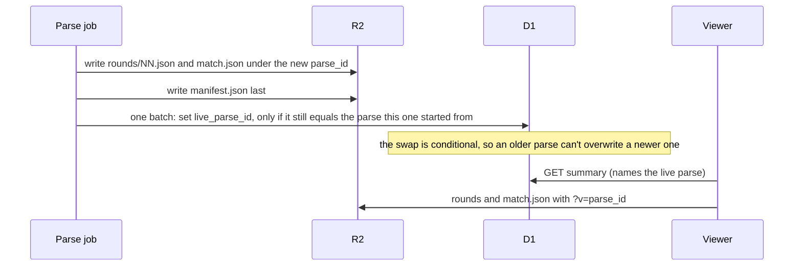

# R2 layout and versioned parses

> **Approved by the user** (recorded in `notes.md`, `4e06e12`), together with its D1 columns. **The parser side (`1a02084`) and the Worker's pointer swap, versioned URLs and reparse route (`074f5b7`, `a37fc0d`, `fff16cd`) are committed.** The 7-day cleanup is built too (`9d5ead9`, daily). The *current* layout is in the first section.

## Today

```text
demos/{match_id}.dem
parsed/{match_id}/match.json
parsed/{match_id}/rounds/{NN}.json
maps/radars/*   maps/radar_info/*   maps/available.json   maps/manifest.json
```

A parse overwrites those keys in place, which is safe for a retry. It has one flaw: a reparse that yields fewer rounds leaves the old `rounds/NN.json` files behind. They are harmless today, because the round list comes from D1, but they are still reachable by URL.

## Proposed for v1.1

Each parse gets its own prefix, and D1 says which one is live.

```text
parsed/{match_id}/{parse_id}/manifest.json     counts and sha256s, written last
parsed/{match_id}/{parse_id}/match.json
parsed/{match_id}/{parse_id}/rounds/{NN}.json
```



**Why a pointer.** A reader polling during a reparse must never see a 404 or a mix of two parses. Old files stay where they are until D1 points somewhere else, and the pointer moves in a single step.

### Rules

| Rule | Detail |
| ---- | ------ |
| Commit marker | `manifest.json` is written last. Its presence means the parse is complete. |
| The swap | One D1 batch sets `live_parse_id`, conditional on the previous value. All success writes go in the same batch. |
| URLs | `/rounds/:n?v=<parse_id>` and the same for `match.json` serve that parse with an **immutable** cache header. Without `v`, the route serves the live pointer with a **short** cache. |
| A pruned version | If a versioned URL returns 404, the viewer refetches the summary once and tries the new pointer. |
| Cleanup | Parses D1 no longer points to are deleted after **7 days**. |
| v1 files | Files directly under `parsed/{id}/` from before this change are deleted **by exact key**. Cleanup never lists or deletes the whole `parsed/{id}/` prefix, because that is the parent of the new prefixes. |

### The parser's side of the contract (committed)

- `POST /parse` requires a `parse_id`, which the Worker picks for each attempt.
- Output goes to `parsed/{match_id}/{parse_id}/`: round files first, then `match.json`, then `manifest.json` last as the commit marker.
- Responses carry `X-Parse-Id`, and `X-Manifest-Sha256` on success.
- Every error body now has a `code` (from the parser's classifier, or `unauthorized`) next to the message.
- Log lines gain `parse_id`, `build` and `round_source`.
- The plan proposes `parsed_by` in the manifest to be the build's git sha (`PARSER_BUILD`).

### The Worker's side of the contract (committed)

- Every attempt writes under `parsed/{id}/{parse_id}/`. On a 200 the consumer moves `live_parse_id` and replaces the D1 rows in **one batch**, only if the pointer hasn't moved since the attempt began.
- A reparse job keeps the match `ready` and records a failure in `reparse_error` and `reparse_build`.
- Files are served as `?v=<parse_id>` (immutable) or from the live parse. The viewer asks for a match's files by parse id.
- Matches parsed before parse ids have `live_parse_id` NULL and keep their v1 keys directly under `parsed/{id}/`.
- The columns arrived in migration `0003` (see below).

### What it fixes

A reparse with fewer rounds leaves no old round file reachable, because the new parse is a separate prefix and the old one is removed on schedule.

### D1 columns it relies on

`live_parse_id` (NULL means the v1 layout), `attempted_build` (the build of the latest attempt, so the cron tries each match once per build), `reparse_error`, `reparse_build`, and `status_changed_at` (Unix ms, backfilled from `parsed_at` or `created_at`), all from migration `0003`. `demo_sha256` is indexed by `0002`. All of these are approved. See the [reparse runbook](runbook-reparse.md). These are spec changes and not schema-file changes, so `schema_version` stays 1.

## Still to do

- The spec's own R2 layout section must change to match.
- The Worker's round and `match.json` routes and the viewer's cache keys have to follow the pointer.
