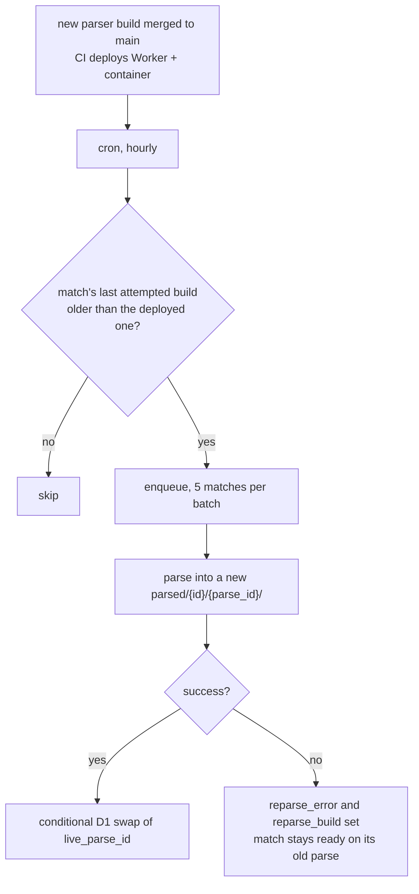

# Runbook: reparsing matches

For when a parser build changes and existing matches should be parsed again. **This describes v1.1 as specified (`6d603ba`).** The reparse route (`a37fc0d`), the pointer swap (`074f5b7`), the D1 columns (migration `0003`) and the hourly cron (`9d5ead9`) are committed. **The crons are on in prod** (`6e305d0`) after the dev exit checks passed: the batch moved every dev match onto the new build unattended, and a failing build left matches `ready` on their old parse.

## How it is meant to work

Properties worth knowing before touching anything:

- **Keyed on the build, not on `match.json`.** A match's `parser_version` can be an oracle version, so the cron compares the *last attempted build*, the `attempted_build` column, and the cron waits while anything is queued or parsing. Each match therefore gets one try per build, and a failing match can't block the rest.
- **The deployed build is injected at deploy**, from the same source as the container image tag. CI passes the parser's build id to the deploy (`c7134a1`). The id is 12 hex characters of a hash of the git trees of `parser/` and `tools/oracle/`, not the commit sha, so a change that touches neither doesn't reparse anything.
- **A failed reparse never takes a match off `ready`.** The match keeps its live parse and its status. The failure lands in `reparse_error` and `reparse_build`.
- **The sweeper and the dead-letter handler don't touch these matches.** They only act on matches that have never been `ready`.
- **Pace.** The cron runs hourly, 5 matches a batch, and pauses at 80% of the monthly container allowance. The user approved exactly these numbers, and approved leaving the cron on in prod. One `basic` instance at about 30 s a parse makes a batch about 3 minutes, so a new upload waits behind at most one batch.
- **New uploads and links don't break.** Round and `match.json` URLs follow the live pointer. See [R2 layout](r2-layout.md), which the user has approved.

## Normal path: nothing to do

Merge a parser change to `main`. CI deploys dev, then prod. The cron picks up every older match over the following hours.

To check it worked:

1. Pick a match and confirm its status is still `ready`.
2. Confirm its `attempted_build` now equals the deployed one.
3. Open its replay and confirm it plays.
4. Look for the batch in the Worker logs (`match_status` lines, and one `parse_call` line per attempt).

## Reparse one match by hand

`POST /api/matches/:id/reparse`, with `Authorization: Bearer <UPLOAD_TOKEN>` (committed, `a37fc0d`). Use it to retry a match after a fix, or to test on dev. The same safety rules apply: the match stays `ready` while it runs.

## If a reparse fails

1. Read `reparse_error` for the match. Errors keep the parser's error code.
2. Check the `parse_call` log line for that attempt: status code, attempt number and duration.
3. If it is the demo, the same code will come back on every build. Don't retry blindly.
4. If it is the build, fix it and merge. The next build gets a fresh attempt for every match, including this one.
5. If the container was killed for memory, the container log shows exit code 137.

## Don't

- Don't delete files under `parsed/{id}/` by hand. Cleanup removes superseded parses by exact key after 7 days, and a listing delete can take out the new prefixes.
- Don't change a match's `status` in D1 to force a rerun. Use the route.
- Don't run a large batch by hand on prod near the monthly allowance. The cron's 80% pause exists for that.

## Related

[Stuck-match recovery](runbook-stuck-matches.md), [R2 layout](r2-layout.md), [Worker](worker.md), [infra](infra.md).
