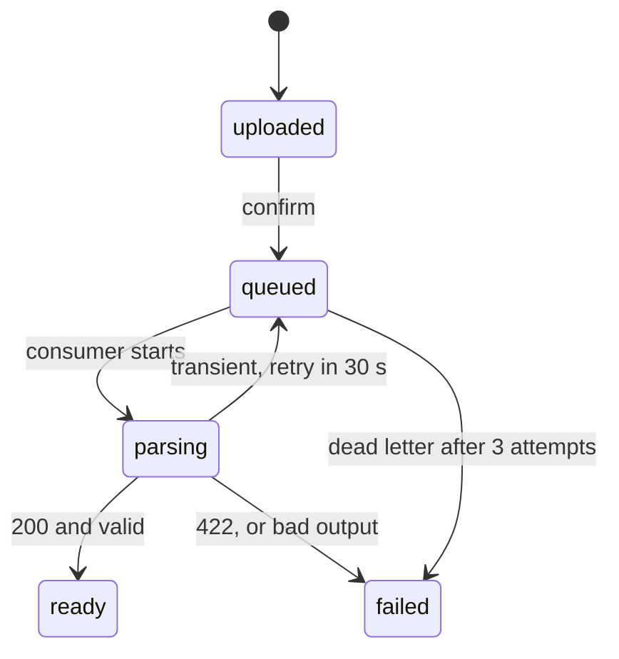

# Runbook: stuck and failed matches

For a match that sits in `queued` or `parsing`, or ends `failed` and shouldn't have. **The sweeper is built (`9d5ead9`), and its cron is on in dev only for now.** `status_changed_at` exists (migration `0003`). Coded errors have landed: the Worker stores a code with every failed match's error (`2f91766`), and the match page explains failed matches and unreadable data formats (`ed662e1`).

## What exists today

The Worker logs one JSON line for every change, every parse attempt, every dead letter and every rejected confirm. The events to look for:

| Log event | What it tells you |
| --------- | ----------------- |
| `match_status` | Every status change, with the attempt number and the error when there is one |
| `parse_call` | One per attempt: status code, attempt of 3, whether it is the final one, duration, result |
| `dead_letter` | A message that used up its attempts, with the last error |
| `confirm_rejected` | An upload confirm that was refused, with the reason (wrong status, demo missing, concurrent) |
| `match_events` (D1) | Not a log line but a table: every status change, parse attempt, reparse request and cleanup per match, served by `GET /api/matches/:id/events` and shown on the match page (`1df36df`, `ed9700b`). It outlasts the Worker logs |
| `job_skipped` | A redelivered message for a match that is already finished, acked and ignored |
| `container_start`, `container_stop`, `container_error` | The parser container's lifecycle. Exit code 137 is an out-of-memory kill |

## Diagnosing a stuck match

0. **Start with the match's history.** The match page shows its pipeline history, and `GET /api/matches/:id/events` returns the same rows.
1. **Which status, and since when?** Read the match's row. A `queued` match with an error text is waiting for a retry, which is normal for up to 30 s per attempt.
2. **Look at its `match_status` and `parse_call` lines** in the Worker logs. They give the attempt number and what the parser answered.
3. **A 422** means the demo is invalid. The match is `failed` and will not retry. That is correct.
4. **A 5xx or timeout** is transient. After three attempts the message goes to the dead letter queue and the match becomes `failed` with the last error attached.
5. **No `parse_call` line at all** means the job never reached the consumer. Check the queue and the `confirm_rejected` lines.
6. **`container_error` or exit code 137** means the parser itself died. Check memory against the 1 GiB `basic` instance before blaming the demo.
7. **Never `ready`, never failed, and nothing in the logs** is the case the sweeper exists for. Until it lands, requeue by hand and note it.

## What v1.1 adds

- **A sweeper** requeues or fails any match that has been in `queued` or `parsing` for more than **30 minutes since its last status change**, using a new `status_changed_at` column.
- **It only touches matches that have never been `ready`.** A reparse of a ready match is the [reparse runbook](runbook-reparse.md)'s business.
- **Coded errors (landed).** D1 keeps the parser's error code beside the text, and the match page shows a message for each code instead of raw text. The parser's own responses carry the code too (`1a02084`).
- **A fault flag** for testing, dev only, which deploy config refuses in prod. With it on, 20 uploads must each end `ready` or `failed` with a coded error, and none may sit in `queued` or `parsing` for 30 minutes past its last change.
- **Upload hygiene.** A per-token rate limit, and an R2 lifecycle rule that removes orphaned demos (uploaded but never confirmed).

## Rules of thumb

- A match in `failed` because of a 422 is not stuck. Check the error code before reaching for a retry.
- Match status only moves forward through the machine. If you find yourself wanting to edit it by hand, find out why first.
- Always check the logs before the data. The log trail for one match is complete.

## Related

[Reparse runbook](runbook-reparse.md), [Worker](worker.md), [infra](infra.md).
