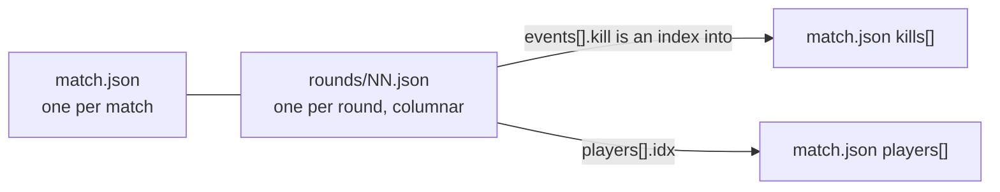

# The schema

`schema/` is the contract. The parser writes it, and the Worker, the viewer and the diff tool read it. Because it was fixed early, the cloud pipeline and the viewer were built on synthetic samples before the parser could produce anything.

**Rule:** don't change schema files without proposing it to the user first. A breaking change bumps `schema_version` (currently 1).

| File | What |
| ---- | ---- |
| `match.schema.json`, `round.schema.json` | JSON Schema, draft 2020-12 |
| `validate.mjs` | The schemas plus cross-field checks: column lengths, frame ranges, unique ids, references into `match.json` |
| `samples/` | A synthetic 22-round Mirage match, 13 to 9, with round files for rounds 1, 2, 16 and 21. Regenerated deterministically. |

```sh
cd schema && npm test                        # samples, --strict
cd schema && npm run validate -- <out dir>   # parser output
```

Validation reports **errors** (rule breaks, which fail) and **warnings** (conventions the spec leaves open, which `--strict` also fails). The real Nuke export has 2 warnings, from kills during freeze time. See below.

## Two kinds of file



**`match.json`** holds the whole match: `match` (map, tick rate, demo sha256), `players`, `rounds`, `kills` and `scoreboard`. Teams are `A` and `B` for the whole match, since sides swap at halftime. Each round records which side team A played (`side_a`).

**`rounds/NN.json`** is stored as columns, so the viewer indexes a frame directly:

```json
{ "round": 7, "hz": 64, "start_tick": 0, "frames": 7600,
  "players":  [{ "idx": 0, "x": [], "y": [], "yaw": [], "hp": [] }],
  "grenades": [{ "type": "smoke", "thrower": 3, "throw_frame": 120,
                 "detonate_frame": 180, "end_frame": 470, "path": [[0, 0]] }],
  "events":   [{ "frame": 210, "type": "kill", "kill": 12 }] }
```

Positions are integers in game units. `hp` 0 means dead. **v1 writes every tick (64 Hz).** A long round is about 7,600 frames, up to roughly 2 MB before compression in the spec's estimate. The first plan was 16 Hz, then 32.

## A third file: `pulse.json`

Match Pulse adds a new file with its **own `pulse_version`** (1), described by `schema/pulse.schema.json`. `match.json` and the round files are untouched, so `schema_version` stays 1 (`9b0251d`). The validator pairs a pulse file with the `match.json` beside it and checks that its rounds exist there, that moment ticks strictly increase within a round, and that every `swing_tick` is one of the moment ticks. See [pulse](pulse.md).

## Conventions

Most of these were gaps in the spec. They've been settled, and both the oracle and match logic follow them.

**Players and teams**
- `idx` runs 0..N−1 in array order. Team A comes first, and A is the team on CT in round 1.
- Anyone who played a live round is in. Spectators, coaches and GOTV are out. Bots who played get `steam_id` `"0"`.

**Rounds and time**
- Round `reason` is one of `elimination`, `bomb_exploded`, `bomb_defused`, `time_expired`, `surrender`.
- A kill between one round's end and the next's start belongs to the round that just ended. Kills are sorted by tick.
- A surrender during freeze time sets `freeze_end_tick = end_tick`.
- Ticks are the demo-frame tick, never `net_Tick`.

**Round files**
- `start_tick` is the round's `freeze_end_tick`. Frame `i` is tick `start_tick + i·tick_rate/hz`. A kill's frame is `ceil((tick − start_tick)·hz/tick_rate)`, the first frame where the victim has 0 hp.
- `hz` is read from the file and never assumed. Files are `NN.json`, zero-padded to two digits. The API route `/rounds/:n` is unpadded.
- Dead players hold their death position with `hp` 0. Only players who spawned that round are listed.
- `yaw` is integer degrees in [0, 360), where 0 points along +x and angles run counterclockwise.
- Grenade types: `smoke`, `flash`, `he`, `molotov`, `incendiary`, `decoy`. `path` has one `[x, y]` per frame from throw to detonation. `end_frame` depends on the type: flash and HE end at detonation, smoke when the cloud clears, fire when it goes out.
- Event types: only `kill` in v1. Adding bomb events would be a schema change.

**Kills**
- `attacker` is null for world, fall and bomb deaths. For a suicide, `attacker == victim`.
- `weapon` is the raw name without `weapon_`.

<!-- widget: ticks -->

## Known tension

Kills during freeze time (Nuke has 2 bot deaths during a tactical pause) clamp to frame 0, since the round window starts at freeze end. **Proposed:** accept the clamp. The alternative is starting round files at the round start, which breaks `start_tick = freeze_end_tick`. Not yet decided.

## Open questions touching the schema

- **Steam ids in public data: decided, keep them.** The user judged them semi-anonymous behind unlisted links. `match.json` serves them, the summary GET omits them, and `steam_id` stays non-nullable, so there is no schema change.
- **Round-file rate: decided, 64 Hz.** Both fixture demos record entity updates on every tick, and the viewer targets desktop. The spec says 64, and the oracle (`9ab7e1f`) and the regenerated samples (`83d1e20`) now write 64. The oracle's files are compact: at most 1.5 MB raw, about 100 KB gzipped. `hz` is in the file, so this is a parser setting and not a schema break.
- **Narrative log.** Proposed as a new output with its own `log.schema.json`, independent of `schema_version`. See [decisions](decisions.md#narrative-log).
