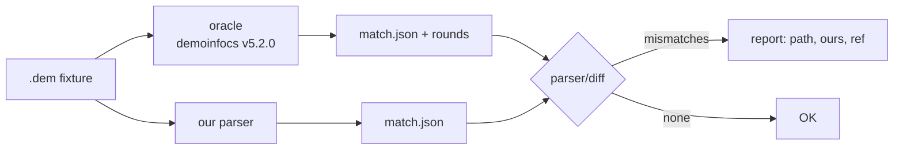

# How we know it's right

Parsing a binary format from scratch is easy to get *almost* right. The strategy is to run a trusted parser over the same demos and compare.



## The oracle

`tools/oracle/` is a separate Go module so `parser/` *cannot* import it. It uses demoinfocs-golang v5.2.0 (pinned) and writes our schema exactly: `match.json` plus round files, with `parser_version` `0.1.0-oracle+demoinfocs.5.2.0`.

```sh
cd tools/oracle && go run . export path/to/match.dem --out ../../parser/testdata/reference/<name> [--hz N]
```

`-` reads the demo from stdin, which the server uses.

It does double duty. It's the answer key, and it's the v1 round-file source until our entity decoding passes. That's the spec's Fallback rule, which is the default path and not a failure mode.

Checked against the game's own counters, it matches K, A and damage exactly on both demos. It now writes round files at 64 Hz by default. On the largest demo at `GOMAXPROCS=1` its peak was 640 MiB, which was over the parser's budget. Keeping per-tick samples compact (`23e232c`) cut that to about 269 to 318 MiB, with byte-identical output.

Gotchas to watch when diffing, found during research:
- demoparser2 duplicates `round_officially_ended`.
- demoinfocs's `InfernoExpired` is not the moment the flames go out. The oracle now reads the game's own fire events instead (`5d0c7fe`).
- demoinfocs v6 changes damage and health semantics, which is why v5.2.0 is pinned.

## `parser/diff`

It reads both sides as plain JSON into its own minimal types, so it doesn't depend on the parser's Go types. `Compare` checks `match.json`:

| What | Rule |
| ---- | ---- |
| Players | matched by `steam_id` (bots by name) |
| Rounds | by `n`, every field exact |
| Kills | in order. Tick, attacker, victim, weapon, round, headshot and assister all exact |
| K/D/A, HS% | exact |
| ADR | within ±1% |

`CompareRound` checks round files: x and y within 1 unit, yaw within 1°, hp exact, plus grenades and events. That one waits for M4.

Mismatches name the field path: `kills[12].weapon: ours ak47, reference m4a1`. Output is capped at 40 lines, but the count is always complete.

## Radar alignment

`tools/align` is a standard-library Go tool that reports the share of alive player frames landing on a non-transparent radar pixel, per demo and per round. It exits 1 below the bar, which is **97.5% per demo**. It runs locally and on dev, not in CI, because the radars are unlicensed private objects. Measured shares and the reasoning are on the [maps](maps.md) page.

## The pro-demo sample

A bulk run over 132 public tournament demos is the only test so far that stresses match logic beyond matchmaking. It found no crashes and fast parses, but segmentation problems on most. See [match-logic](match-logic.md#tournament-gotv-demos-found-root-cause-fixed-re-run-pending). A pinned subset is planned for CI, fetched at test time from its public source and never rehosted. The swap-in's default stays on the oracle until this sample passes.

## Fixtures

Demos are never committed. Local copies go in `parser/testdata/demos/` (gitignored). CI pulls the public ones from the R2 bucket `demoview-fixtures`, which holds those two only.

| Demo | Source | Notes |
| ---- | ------ | ----- |
| `faceit_nuke_2026.dem` | FACEIT, patch 14165, from demoinfocs's test-demo repo | 19 rounds, 11 players (one bot) |
| `valve_mm_mirage_2024.dem` | Valve MM, patch 13984, bundled with demoparser2 | 10 rounds. Older patch, so it still fires `round_start` and `round_end`. |
| the user's own | 8 MM/Premier demos | In the local demos folder only (gitignored). Includes one with overtime. `demo diff` passes on these. Still wanted: a scoreboard screenshot of a match the user played. |

The two public demos were an *interim* choice, and they are still the ones CI can see. Locally, `demo diff` passes on all 10 demos, and one of the user's own has overtime. The user's demos are never named, committed or uploaded to the shared bucket. Mirage is useful precisely because it's older: the same code has to handle demos with and without the round events.

## The test layers

| Layer | Where | What it proves |
| ----- | ----- | -------------- |
| Unit tests | `go test ./...`, `npm test` | Pieces behave. Match logic is tested with hand-built logs. |
| Wiring tests | `parse/wiring_test.go` | A synthetic one-round 1v1 demo (`parsetest.Match()`) flows through `Run` into players, rounds, kills and scoreboard. |
| Schema validation | `schema/validate.mjs --strict` | Output obeys the contract. |
| Diff | CI `diff` job | Our output equals the oracle's on real demos. |
| Truncation | `TestTruncated` | Every public fixture cut at 1,000 offsets is `bad_demo`, with no panic. |
| Run twice | `TestRunTwiceIdentical` | Two separate processes give byte-identical `match.json` on all 10 local demos. |
| Budget | `TestBudget` | The largest demo at `GOMAXPROCS=1` stays far under 512 MiB and 60 s on the events-only path. The full path with the oracle measured 270 MiB. |
| Per-map diff | `TestReferenceDiff` | One subtest per map and demo, five maps, all OK. |
| Fuzzing | `bitread`, `FuzzFrames`, `FuzzApply`, `FuzzFieldPaths` | Corrupted input is rejected, never a crash. Corpora are generated at test time, so no demo bytes are committed. |
| Round files | `demo diff` on `rounds/` | Our own round files against the oracle's on all 10 demos: players and kills have zero mismatches, and runs are byte-identical. |
| Entity state | `parser/entities` tests | Decoded pawn position, view angle and health agree with the oracle on every frame of all 10 demos, and full-packet state equals state built from deltas. |
| Reparse | Worker tests | A reparse with fewer rounds hides the old extra rounds (`16c8041`). |

Tests that need real demos skip when the files are absent, so CI stays green on forks. The CI `diff` job also skips with a notice when the fixture secrets are missing.

## Watch for

- **ADR.** The diff allows ±1%, but in practice ADR is exact: HP before minus HP after matches the game's `m_iDamage`.
- **Round inference vs reality.** Winners come from events until entity decoding, so a surrender or backup restore can break a round. Match logic emits notes when its inference disagrees with `round_end`.
