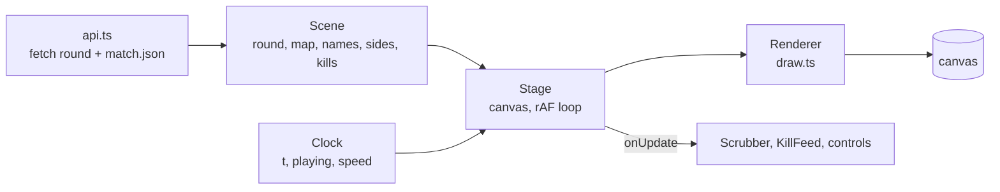

# The viewer

`web/`. A static Vite + Preact + TypeScript SPA. It fetches finished files and draws them. It does no analysis. The production bundle is about 46 KB raw and 18 KB gzipped, because Preact was chosen over React on purpose (the first React build was 220 KB). Import from `preact` and `preact/hooks`, not `react`.

## Pages

| Route | Shows |
| ----- | ----- |
| `/` | Upload form: file picker, token field, progress |
| `/m/:id` | Parse status (polled), then map, score, scoreboard and round list |
| `/m/:id/r/:n` | The 2D replay. `?t=42` opens at 42 seconds. |

The router is a small History API wrapper in `router.ts`. A query-string change from the replay (`?t=` written with `replaceState`) doesn't re-render the page.

**Fixtures mode.** `/m/sample` always replays `schema/samples`. `VITE_FIXTURES=1 npm run dev` runs the whole app with no backend. That's how it was built before any parser or cloud existed.

## Replay anatomy



Each piece knows as little as it can:

- **`Clock`** is a position in seconds, a play state and a speed (0.5×, 1×, 2×, 4×). It knows nothing about frames or the DOM. Playing from the end restarts.
- **`Stage`** owns the canvas and the `requestAnimationFrame` loop. It draws only while playing or after a change. One animation step is capped at 0.25 s, so a backgrounded tab doesn't leap ahead on return. It observes device-pixel size, so it stays sharp across zoom and monitor changes.
- **`Renderer`** draws one moment given a fractional frame. The radar background is cached per size.
- **`timeline.ts`** converts between time, frames and ticks, and places kills on the timeline.

## Smooth at any refresh rate

Data is now every tick (64 Hz), and the display is 60 to 144 Hz. The two rarely line up. The Renderer takes a *fractional* frame and linearly interpolates positions between the two neighbours (`sampleAt` in `interp.ts`). Yaw interpolates along the shorter arc, so 359° to 1° passes through 0 and doesn't spin the long way.

Time zero is the end of freeze time: playback time `t = frame / hz`.

<!-- widget: interp -->

## Map coordinates

A radar image is `size × size` pixels. Game coordinates map onto it with three per-map constants:

```text
px = (x - pos_x) / scale
py = (pos_y - y) / scale        // game y points up, image y points down
```

Mirage: `pos_x` −3230, `pos_y` 1713, `scale` 5.0, on a 1024×1024 radar. These were checked by plotting real Mirage positions from the oracle export, and the trails follow the corridors. Radar images come from MurkyYT/cs2-map-icons at ae7ed6a, which has no license, so treat them as Valve assets. If a map's image is missing, a placeholder is drawn.

<!-- widget: radar -->

## What's drawn

- Players are team-coloured dots (CT blue, T amber) with a name and a view-direction wedge.
- A dead player becomes an X where they died. A brief ring marks the kill.
- Grenades draw their flight path, then an effect: smoke (144 u radius) for its duration, fire (120 u), and a short pulse for flash (200 u) and HE (260 u).
- The kill feed stays in sync with playback. The scrubber marks each kill.
- Space toggles play, and arrow keys step 5 s. The scrubber works by touch, though v1 now targets desktop browsers (`d56ca5a`), so a phone is no longer part of the done-when.
- The next round is prefetched in the background.
- Each player's name goes beside its dot on the first side that doesn't cover a name already placed (right, left, above, below), so names no longer run together (`eb51eb1`).
- While playing, the clock, scrubber and kill feed update ten times a second instead of every display frame, and pausing or seeking still updates at once (`17c2e4f`). Leaving the upload page cancels an upload in flight (`c277646`).

## Tests

50 vitest tests cover the pure parts: clock, interpolation, timeline, maps, fixtures. The canvas itself is checked by eye.
