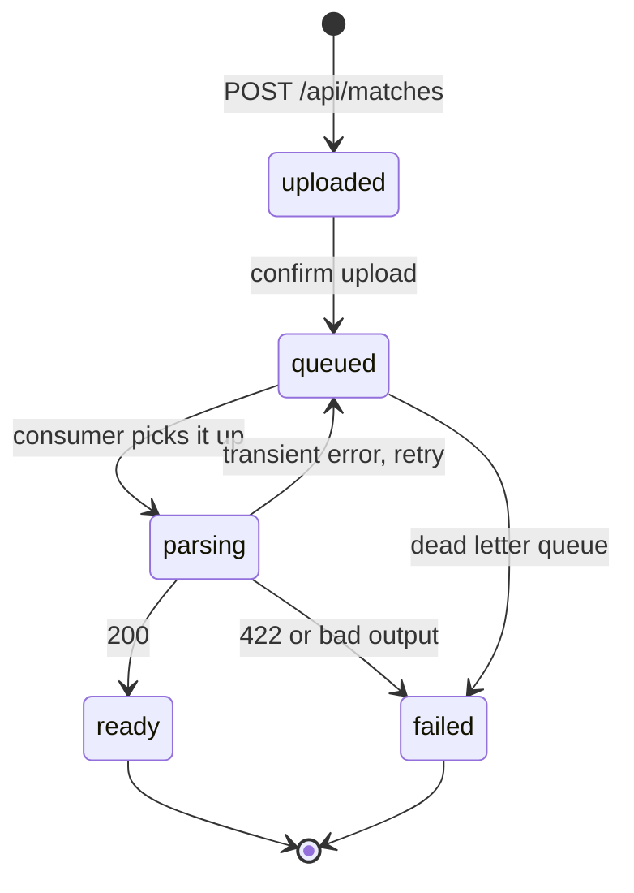
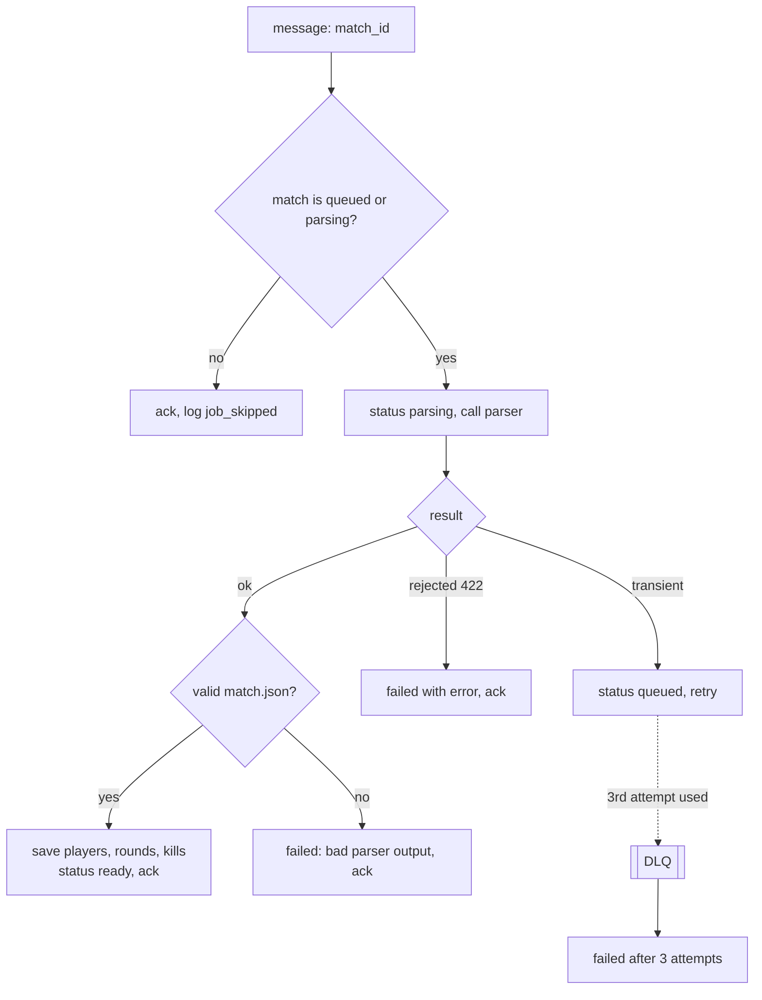

# The Worker

`worker/`. One Cloudflare Worker doing three jobs: the public API, the parse queue consumer, and hosting the viewer's static files. It owns D1, and nothing else touches the database.

## Routes

Uploads need `Authorization: Bearer <UPLOAD_TOKEN>`. Reads are open. Errors are `{ "error": "..." }`.

| Route | Does | Notable errors |
| ----- | ---- | -------------- |
| `POST /api/matches` | Create a row and return `{id, upload_url, upload_expires_in}` | 401 |
| `POST /api/matches/:id/uploaded` | Confirm the object, enqueue, return 202 | 409 not uploaded yet or wrong state. 413 over 1 GB (demo deleted, match failed) |
| `GET /api/matches/:id` | Status, scoreboard and round list from D1, `no-store` | 404 |
| `GET /api/matches/:id/match.json` | The parser's `match.json` from R2, 5 min cache with ETag | 404 until `ready` |
| `GET /api/matches/:id/rounds/:n` | A round file from R2, immutable for a year | 404 |

The last two weren't in the original spec. The viewer needs `match.json` for the kill feed, and kills in D1 lack assisters. The public GET leaves Steam ids out.

**Presigning.** Uploads go straight to R2 via a presigned PUT, so the Worker needs R2 S3 credentials as secrets. The bucket CORS rule allows `PUT` from the Worker's origin.

**Same origin.** The viewer is served from `../web/dist` by this same Worker (`assets` in `wrangler.jsonc`, SPA fallback). `/api/*` always runs the Worker first. So the API needs no CORS.

## Match status

<!-- widget: status -->

`uploaded` means "created, awaiting upload". Plan proposes renaming it `pending`. While a retry waits, the match is back in `queued` with the last error attached. Every change logs one JSON line, `{"event":"match_status",...}`.

## The consumer

- Retries: `max_retries: 2`, so 3 attempts in total, with a 30 s delay. `MAX_ATTEMPTS` in `consumer.ts` must match `wrangler.jsonc`.
- One job per batch, since a parse can take minutes.
- A stale or duplicate message is acked and skipped. That makes redelivery safe.
- Bad output is final, since retrying would return the same thing.
- The Worker also consumes the DLQ to mark matches failed.
- The consumer reaches the parser through a `ParserContainer` binding. See [infra](infra.md#parser-runtime).

## Data

D1 holds `matches`, `players`, `rounds` and `kills` (migration `0001_init.sql`). Timestamps are Unix ms, and 1 GB means 1024³ bytes. The scoreboard score (`score_a`, `score_b`) is computed by counting round winners. Reparse caching is handled in the viewer: URLs carry `?v=<parsed_at>`, so a reparse never serves stale files.

## Environments

The top level of `wrangler.jsonc` is **dev**, so a bare `wrangler deploy` can never touch prod. Prod is `--env prod`. Bindings and vars aren't inherited, so prod repeats them. Names follow `demoview-{dev,prod}` for D1 and R2, and `demoview-{dev,prod}-parse[-dlq]` for queues. The account and database ids are committed on purpose (user-approved).
