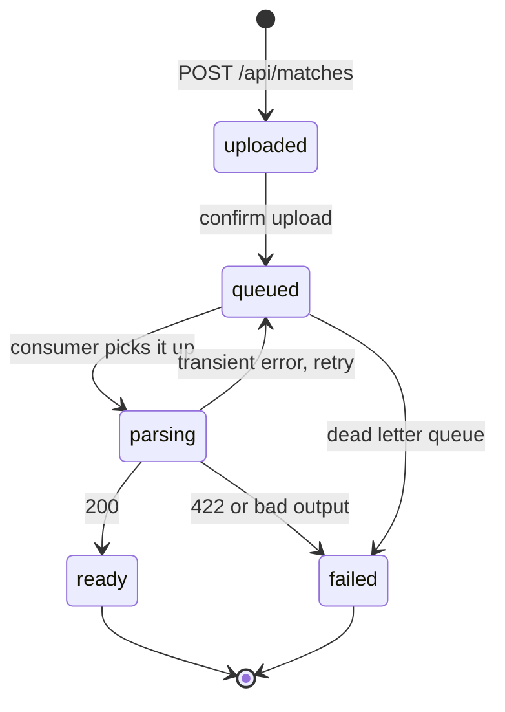
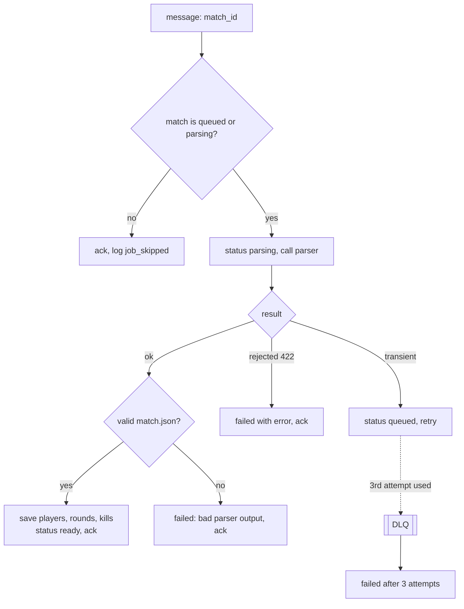

# The Worker

`worker/`. One Cloudflare Worker doing three jobs: the public API, the parse queue consumer, and hosting the viewer's static files. It owns D1, and nothing else touches the database.

## Routes

Uploads need `Authorization: Bearer <UPLOAD_TOKEN>`. Reads are open. Errors are `{ "error": "..." }`.

| Route | Does | Notable errors |
| ----- | ---- | -------------- |
| `POST /api/matches` | Create a row and return `{id, upload_url, upload_expires_in}` | 401 |
| `POST /api/matches/:id/uploaded` | Confirm the object, enqueue, return 202. **Duplicate:** the object is hashed as a stream (SHA-256), and if a match that hasn't failed already has the same demo, return `200 { id, status, duplicate: true }` for that match, delete the duplicate object and start no parse (`25c96a6`) | 409 not uploaded yet or wrong state. 413 over 1 GB (demo deleted, match failed) |
| `GET /api/matches/:id` | Status, scoreboard and round list from D1, `no-store` | 404 |
| `GET /api/matches/:id/match.json` | The parser's `match.json` from R2, 5 min cache with ETag | 404 until `ready` |
| `GET /api/matches/:id/rounds/:n` | A round file from R2. With `?v=<parse_id>` it is that parse's file, immutable. Without it, the live parse's file (`074f5b7`) | 404 |
| `GET /api/matches/:id/events` | The match's pipeline history from D1: every status change, parse attempt (build, parse id, outcome, time), reparse request and cleanup (`1df36df`) | 404 |
| `POST /api/admin/cron/:job` | Run the sweeper, the reparse batch or the cleanup by hand, so checks don't wait for the clock (`b64b6db`) | |
| `POST /api/matches/:id/reparse` | Queue a reparse. The match stays `ready` on its live parse while it runs (`a37fc0d`) | 401, and 429 past the rate limit |
| `GET /api/maps/:name` | `{ name, pos_x, pos_y, scale }`, cached a day (`091b2b5`) | 404 no radar, or a two-floor map |
| `GET /api/maps/:name/radar.png` | The radar image, cached a day, with an ETag | 404 |

The last two weren't in the original spec. The viewer needs `match.json` for the kill feed, and kills in D1 lack assisters. The summary GET leaves Steam ids out. `match.json` carries them, by the user's decision to keep them.

**Presigning.** Uploads go straight to R2 via a presigned PUT, so the Worker needs R2 S3 credentials as secrets. The bucket CORS rule allows `PUT` from the Worker's origin.

**Same origin.** The viewer is served from `../web/dist` by this same Worker (`assets` in `wrangler.jsonc`, SPA fallback). `/api/*` always runs the Worker first. So the API needs no CORS.

## Match status

<!-- widget: status -->

`uploaded` means "created, awaiting upload". Plan proposes renaming it `pending`. While a retry waits, the match is back in `queued` with the last error attached. Every change logs one JSON line, `{"event":"match_status",...}`.

## The consumer

- Retries: `max_retries: 2`, so 3 attempts in total, with a 30 s delay. `MAX_ATTEMPTS` in `consumer.ts` must match `wrangler.jsonc`.
- One job per batch, since a parse can take minutes.
- A stale or duplicate message is acked and skipped. That makes redelivery safe.
- Bad output is final, since retrying would return the same thing.
- The Worker also consumes the DLQ to mark matches failed.
- The consumer reaches the parser through a `ParserContainer` binding. See [infra](infra.md#parser-runtime).

## Background jobs and limits

Committed in `9d5ead9` and later. **The crons are on in prod** as of `6e305d0`, after the dev exit checks passed: the hourly batch moved all three dev matches, one of them from the v1 layout, onto new parses with nothing run by hand, while a poller made 9,228 requests over 75 minutes and saw no 404 and no mismatch between D1, `match.json` and the round files, and a deliberately failing build (the dev-only `FAULT` flag, `5994791`) left the reparsed matches `ready` on their live parse. CI still refuses to deploy prod with that flag set (`22b3884`).

| Job | What it does |
| --- | ------------ |
| Sweeper | Requeues or fails matches stuck in `queued` or `parsing`, using `status_changed_at`. |
| Reparse batch, hourly | Takes up to 5 `ready` matches whose `attempted_build` isn't the deployed build, waits while anything is queued or parsing, and stops at 80% of the month's container allowance. |
| Cleanup, daily | Deletes superseded parses after 7 days, and uploads left unconfirmed for a day, with their demo. |

- **Build id.** `PARSER_BUILD` is 12 hex characters of a hash of the git trees of `parser/` and `tools/oracle/` (`c7134a1`), not the commit sha, so a web-only merge reparses nothing.
- **Parse ids.** 9 base32 characters of time plus 7 random, one per attempt.
- **Rate limit.** Uploads and reparses are limited to 10 a minute (`856d8c5`), and the viewer says so when it happens (`94dba79`).
- **Container settings per environment** (`e439244`). Dev's container runs with `PARSER_ROUNDS=parser` and `PARSER_SHADOW=oracle`, and sleeps after 2 minutes so the compare after each response can finish. Prod stays on the oracle's round files, set explicitly, and an empty value is never passed on.
- **Left for `cloud`:** the R2 lifecycle rule for orphaned demos.

## Data

D1 holds `matches`, `players`, `rounds` and `kills` (migration `0001_init.sql`), plus `match_events` (a row per status change, parse attempt, reparse request and cleanup, so a match's history outlasts the Worker logs) and `container_usage` (container time per month), from migration `0004`. Timestamps are Unix ms, and 1 GB means 1024³ bytes. The scoreboard score (`score_a`, `score_b`) is computed by counting round winners. Reparse caching is handled in the viewer: URLs carry `?v=<parsed_at>`, so a reparse never serves stale files.

## Environments

The top level of `wrangler.jsonc` is **dev**, so a bare `wrangler deploy` can never touch prod. Prod is `--env prod`. Bindings and vars aren't inherited, so prod repeats them. Names follow `demoview-{dev,prod}` for D1 and R2, and `demoview-{dev,prod}-parse[-dlq]` for queues. The account and database ids are committed on purpose (user-approved).
